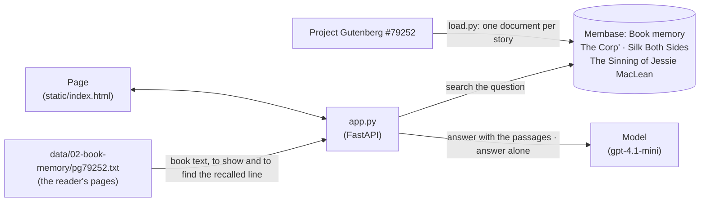
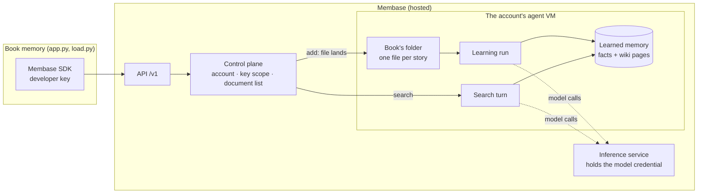

# Book memory

*Doorways in Drumorty* (Lorna Moon, 1925) is a little-read book of stories about a Scottish
village. The model has not read it. Ask it "How did Sandy MacNab die?" and it guesses: a fall
from a ladder, a horse, an illness. The book says he "choked on a cold potato and hiccoughed
himself to death". This demo is a reading app, *Lamplight*, with the book open and a reading
companion beside it. Three of the stories are in a Membase memory: those are the ones the
companion "has read". Every question is answered twice by the same model. One answer gets the
passages that memory recalls; the reader turns to the lines they come from, marks them, and
names the story in the margin. The other answer has only the model's training.

**Base:** hosted Membase by default. Set `MEMBASE_DEMO_MODE=local` to run it on the local engine
instead.

## Video

https://github.com/user-attachments/assets/fe3475af-c4fb-40f5-bd5d-d5698fc62c9b

51 s · hosted Membase. After a short explainer of how the app and Membase fit together:

1. **The book is in memory.** *Doorways in Drumorty* (Lorna Moon, 1925) open at its title page in a reading app. Three of its six stories carry a green ribbon: the hosted Memory learned them, so the companion "has read" them.
2. **Ask** *"How did Sandy MacNab die?"*
3. **Recall.** The reader opens *The Corp’* and marks the line memory returned: Mistress MacKenty's news that "Sandy MacNab had choked on a cold potato and hiccoughed himself to death". The margin names the story.
4. **Two answers.** *Has read it*: he choked on a cold potato, footnoted to *The Corp’*, page 1. *Hasn't read it*: a fall while working in the woods.
5. **A second question** about Jessie MacLean. The reader turns to *Silk Both Sides* and marks two lines: "six and thirty" and "for fifteen years". *Has read it*: 36, and fifteen years. *Hasn't read it*: 17, and two years.

The model was tested on each sample question first: alone, it gets all four wrong.

## How it works

The stories live in one Membase memory called `Book`, and a model writes both answers. The
page also shows the book itself, from the same Gutenberg text `load.py` wrote into memory (cached
on disk). That text is for the reader's eyes only: no model call ever gets it. The answer with
memory sees only what recall returns.



| What | Where it lives | Written by | Read by |
|---|---|---|---|
| The stories, one document each | `Book` memory | `load.py` (downloads the text, cached in `data/02-book-memory/`) | the search for each question |
| The questions and their right answers (`QUESTIONS` in `load.py`) | the app | you | the page's sample list, `load.py --verify`, `smoke.py`, the video |
| The book's text, page by page | `data/02-book-memory/pg79252.txt` (the download `load.py` caches) | `load.py` | `GET /api/book` for the reader; `app.py` to find the line a recalled passage points at |
| Questions and answers | nowhere | — | — (nothing is written back to memory) |

The page has three parts: the contents on the left, the open book in the middle, the reading
companion on the right. The steps:

| Step | What happens on the page | Membase call | Model's job |
|---|---|---|---|
| **1. In memory** | The contents list all six stories. The three in the `Book` memory carry a green ribbon once they are learned ("read by your companion"); one still learning says so. | `add` (load.py), `documents.list` / `documents.get` | none |
| **2. Ask** | You pick one of four questions, or write your own. The model alone got each sample question wrong, three times out of three, before it was put on the list. | none | none |
| **3. Recall** | Memory is searched with the question. `app.py` finds the sentence of the book each recalled passage points at. The reader opens that story at the page, marks the sentence, and writes the story's name in the margin, with the passage itself when it restates rather than quotes the book. | `search` | none |
| **4. Two answers** | Both answers stream into two cards. *Has read it* gets the numbered passages and cites them as [1], [2]: they show as footnote marks, the margin notes get the same numbers, and a line under the answer says which story and page. *Hasn't read it* gets the book's title and the question, nothing else. | none | answer twice, in one sentence of at most 20 words: from the passages, and from training alone |

The demo does not judge the answer without memory. You read both next to the marked line.

**Finding the line.** A hosted hit is a learned fact, not the book's text: "Jessie MacLean is
described as “six and thirty” (36 years old)." `app.py` looks for the sentence of the book it
came from. Words the fact quotes count most, then the words they share, and the story the fact
cites wins a tie. A local hit is a stretch of the story itself; there the sentence in it that
fits the question best is marked. When nothing matches well enough, nothing is marked, and the
answer's footnote quotes the passage instead.

## How Membase serves it

The app talks to Membase only through the Python SDK (`unibaseio-membase`). The same code runs on
two bases, and what happens behind each call differs.

### Hosted Membase



- **The account is the boundary.** The developer key belongs to one account and reaches only the
  Memories it was given, here `Book`.
- **A story is learned before it can be found.** `add` puts the story in Book's folder as a raw
  file and returns straight away (`queued`). A learning run in the account's agent VM then reads
  it and writes what it learned as facts and wiki pages. `load.py` writes one story at a time and
  waits for each run to finish before it writes the next. A story takes 25–90 s.
- **`load.py` checks before you ask.** It exits non-zero unless every story is there under its
  own title, is learned, and the first question recalls the passage that answers it. The last
  check is a real search.
- **Search is a turn.** `search` runs a recall turn in the same VM over the learned facts. A hit
  is a fact restated from the story, such as "Sandy MacNab is described as having choked on a
  cold potato and died", and it cites its wiki page (`[[drumorty-the-corp]]`). The app maps
  that page back to the story's title. A warm search takes 5–25 s.
- **Model calls stay inside Membase.** Learning and search call models through Membase's
  inference service; no model key goes into the VM. The two answers are the app's own model
  calls, made with its `OPENAI_API_KEY`.

| On the page | SDK call | REST | Inside Membase |
|---|---|---|---|
| Load a story (`load.py`) | `add(text, container="Book", title, custom_id)` | `POST /v1/documents` | The story lands as a file; a learning run reads it into facts |
| Which stories are learned | `documents.list`, `documents.get(id)` | `GET /v1/documents`, `GET /v1/documents/{id}` | The list, then each document's latest learning run |
| Ask | `search(question, container=…)` | `POST /v1/search` | A recall turn over the learned facts |

### Local engine

With `MEMBASE_DEMO_MODE=local`, the same SDK calls are answered in the app's own process by
`unibaseio-membase-core`. The memory lives in `data/02-book-memory/default/`.

- `add` reads a story into a topic tree right away, about 15 s for a story of 12 KB. There is no
  learning run to wait for.
- `search` runs hybrid keyword and vector retrieval over the stories. A hit is a stretch of the
  story's own text, marked `document:` with the story's title. The page marks the sentence in
  that stretch that shares the most words with the question.
- The first search loads the engine; after that a search takes 1–3 s.

## Use it

```bash
uv sync                                   # once, at the repo root
cp .env.example .env                      # OPENAI_API_KEY; MEMBASE_API_KEY for hosted
uv run 02-book-memory/load.py             # three stories into memory (--stories 6 for all)
uv run 02-book-memory/app.py              # open http://127.0.0.1:8702
```

**Hosted.** In the Membase app, create a Memory named `Book` and a developer key that can write,
and put the key in `.env`. Loading takes 2–4 minutes.

**Local.** Add `MEMBASE_DEMO_MODE=local` to `.env`. Loading takes about a minute.

To load your own text instead: `uv run 02-book-memory/load.py --file book.txt --title "My Book"`.
The sample questions are about Drumorty, so write your own.

Then, on the page:

1. The book opens at its title page. On the left, the contents: the three stories in memory
   carry a green ribbon. On the right, the reading companion says it has read three of the six
   stories.
2. Click **How did Sandy MacNab die?**. The first card says *Leafing through the stories…* while
   memory is searched.
3. The title page gives way to *The Corp’*. The line "Sandy MacNab had choked on a cold potato
   and hiccoughed himself to death" is marked in yellow, and the margin says *The Corp’*.
4. Both answers stream. *Has read it*: he choked on a cold potato, with a footnote mark ¹ and
   *The Corp’, page 1* under it. *Hasn't read it*: a guess, such as a fall from a roof.
5. Press **Ask another question** and pick the one about Jessie MacLean. The reader turns to
   *Silk Both Sides* and marks two lines: "six and thirty" and "for fifteen years". Turn pages
   with the arrows at the page's edges or the arrow keys; **Aa** makes the type larger.

## API

| Endpoint | Does |
|---|---|
| `GET /api/book` | The book; every story with its text (paragraphs), whether memory holds it and whether it is learned; the sample questions. |
| `POST /api/ask` | Takes `{question}`. Streams the recalled passages (`passages`, each with `spot`: the story, paragraph and character range of the line it points at, or null), then both answers as `delta` events (`side`: `with` or `without`). |

`smoke.py` loads two stories, asks two of the sample questions, and checks that a recalled
passage holds the answer and names its story, that the line the page marks for it holds the
answer, that the answer with memory is right and cites a passage, and that the model alone does
not know it.
