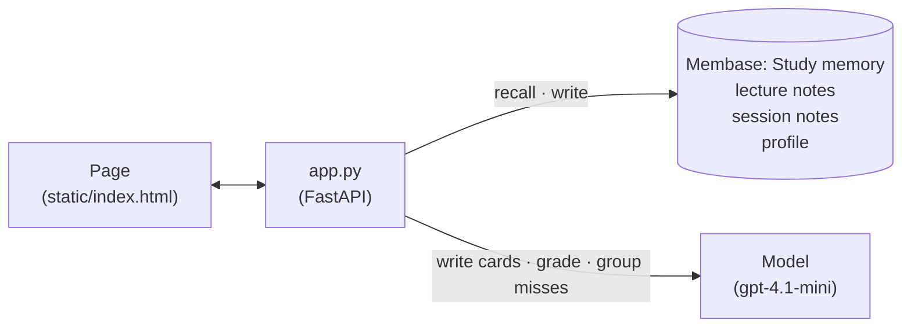
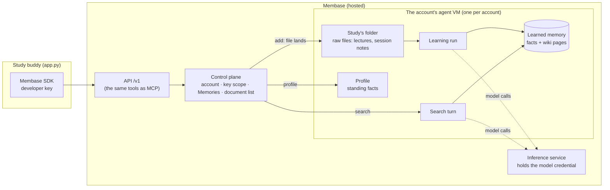
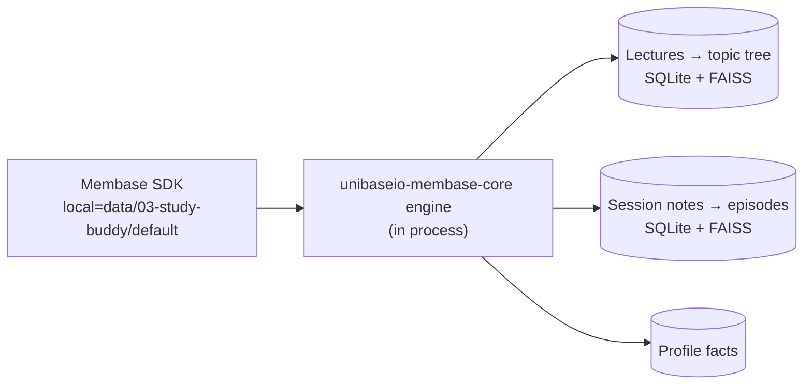

# Study buddy

*Cue* is a flashcard app for a course, here BIO 110, Introductory Cell Biology. Each lecture is a
deck. A card is written from a passage of the lecture notes that Membase recalls, and when you
flip it, the back shows the answer and the line of the notes it came from. A card you miss goes
to your **review pile**, with what you said written in the margin: "you said *mitochondria*".
At the end of the session the misses are one note in memory. Next session, the pile comes back
from memory, and the review deck is dealt from it. Get a card right and it is marked learned.

**Base:** hosted Membase by default. Set `MEMBASE_DEMO_MODE=local` to run it on the local engine
instead.

## Video

https://github.com/user-attachments/assets/9ade94e4-a70a-4f99-947b-2e460dfdc279

85 s · hosted Membase. After a short explainer of how the app and Membase fit together:

1. **A deck from the lecture notes.** The *Cellular respiration* deck is dealt from passages
   Membase recalls: three cards. Two are missed: "mitochondrial matrix" for where glycolysis
   happens, and "NADH" for the terminal electron acceptor. Each flips to the lecture line with
   the answer marked and the wrong answer struck through in the margin, and drops into the
   review pile. 1 of 3.
2. **The session goes into memory.** The session note shows the exact text written: the score
   and one line per miss. Membase learns it.
3. **Next session.** The page is reloaded. The review pile is recalled from memory: two cards,
   each with "you said …".
4. **A review deck from the pile.** One card per miss, with "last time you said *mitochondrial
   matrix*" in the margin. Right this time: the review note is learned, and the pile, recalled
   again, marks both cards *learned*.

The student is simulated: the wrong answers are the deck writer's own typical mistakes, so every
take ends the same way.

## How it works

The app keeps no database of its own. Everything it remembers lives in one Membase memory
called `Study`, and a model does the writing and grading.



| What | Where it lives | Written by | Read by |
|---|---|---|---|
| The course: 5 lecture notes (`course/`) | `Study` memory, one document per lecture | `seed.py` | every deck and review, to write and grade the cards |
| Your results: one note per session, e.g. `Mistake: Confused mitochondria with cytoplasm when asked where glycolysis occurs.` | `Study` memory | the page, when you finish a session | the review pile and the review deck |
| How you like to learn, e.g. "Prefers examples before definitions" | your profile (standing facts) | **Study style** in the top bar | the card writer and the grader |

The page has the decks (or the card in play) in the middle and the review pile on the right.
The steps:

| Step | What happens | Membase call | Model's job |
|---|---|---|---|
| **1 · Notes in memory** | The five lectures are in the `Study` memory; each deck says "Notes in memory" once it is learned. | `add` (seed) | none |
| **2 · A deck** | You pick a deck. Its passages are recalled and three cards are written from them. You write an answer and flip the card; the back shows the answer, the recalled passage it came from (with the answer marked) and a one-line tip. A miss goes to the review pile, with what you wrote. | `search` (several queries on the lecture) | write cards that each cite a recalled passage (uncited ones are dropped); grade each answer against its passage |
| **3 · The session note** | When you finish, the whole session becomes **one** memory: the score, one line per miss, one line per card you now get right. | `memories.add` (once per session) | none |
| **4 · The review pile** | The pile is recalled from those notes. **Start review** deals one card per open miss, from the course passages that explain it, with what you said last time in the margin. | `search` for misses and fixes, then for each miss's passages | group the misses (one per session), name what you said, mark the learned ones; write the review cards |

There is no card bank and no scheduling algorithm. Cards are written from recall each time,
and the review pile is whatever memory holds about your past sessions.

## How Membase serves it

The app only talks to Membase through the Python SDK (`unibaseio-membase`). The same code runs
on two bases, and what happens behind each call differs.

### Hosted Membase



- **The account is the boundary.** The developer key belongs to one account and reaches only the
  Memories it was given (here, `Study`), plus the profile if it was granted profile access. A
  Memory is a named part of that account, not a separate tenant. An app serving many students
  gives each student their own account and key.
- **Writing is two stages.** `add_document` and `memories.add` put a raw file in the Memory's
  folder and return straight away (`queued`). A **learning run** in the account's agent VM then
  reads the new file and writes what it learned as facts and wiki pages. Only after that can
  search find it. That is why the session note waits for "Learned", and why every write waits for the
  previous learning run to finish.
- **Search is a turn.** `search` runs a recall turn in the same VM over the learned facts and
  wiki pages. It returns passages; each cites the page it came from (`[[bio110-03-…]]` for a
  lecture, `[[memory-…]]` for a session note). The app uses that citation to tell course
  material from your results. A warm search takes 5–16 s; the first one after the VM has been
  idle takes longer.
- **Model calls never leave Membase's control.** Learning and search call models through
  Membase's inference service. No model key goes into the VM. The app's own model calls (writing
  questions, grading) are separate and use the app's `OPENAI_API_KEY`.

| On the page | SDK call | REST | Inside Membase | Searchable |
|---|---|---|---|---|
| Seed the course | `add(text, container="Study")` | `POST /v1/documents` | Each lecture lands as a file in Study's folder, and a learning run reads it into facts | When `documents.get(id).learned` is true (30–80 s) |
| A deck: recall the lecture | `search(q, container=…)` | `POST /v1/search` | A recall turn over the learned facts; the hits cite the lecture | — |
| Finish a session | `memories.add(text, container=…)` | `POST /v1/memories` | The session note lands as a file, and a learning run reads it | After its learning run (30–70 s) |
| Review pile, review deck | `search(…)` | `POST /v1/search` | A recall turn; the hits cite `memory-…` pages | — |
| Wait for "Learned" | `documents.get(id)` | `GET /v1/documents/{id}` | Reads the Memory's latest learning run | — |
| Save a preference | `memories.add(text, static=True)` | `POST /v1/memories` | The assistant writes it to the profile's standing facts | When `profile()` lists it |
| Load preferences | `profile()` | `GET /v1/profile` | Reads the profile | — |

### Local engine

With `MEMBASE_DEMO_MODE=local`, the same SDK calls are answered in the app's own process by the
local engine (`unibaseio-membase-core`). Nothing leaves the machine except the model calls the engine
makes with your `OPENAI_API_KEY`.



- `add` reads a lecture into a topic tree right away (about 10 s per lecture).
- `memories.add` turns a session note into episodes right away (about 4 s). The episodes are
  searchable as soon as the call returns, so there is no learning run to wait for.
- `search` runs hybrid keyword and vector retrieval over both stores. Hits are marked
  `document:` or `episode:`, and the app uses that marker to tell course material from your
  results.
- Each directory under `data/03-study-buddy/` is one person's memory, which is how an app on
  the local engine keeps its users apart.

## Use it

```bash
uv sync                                   # once, at the repo root
cp .env.example .env                      # OPENAI_API_KEY; MEMBASE_API_KEY for hosted
uv run 03-study-buddy/seed.py             # put the five lectures in memory
uv run 03-study-buddy/app.py              # open http://127.0.0.1:8703
```

**Hosted.** In the Membase app, create a Memory named `Study` and a developer key that can write,
and put the key in `.env`. Seeding writes one lecture at a time and waits for Membase to learn
each one, about 30–80 s per lecture.

**Local.** Add `MEMBASE_DEMO_MODE=local` to `.env`. The memory then lives in `data/03-study-buddy/`.
Seeding takes about 10 s per lecture, and a session note can be recalled as soon as it is written.

Then, on the page:

1. The decks are in the middle; the review pile on the right says *Nothing to review*. Pick
   **Cellular respiration**. The card area shuffles while the lecture is recalled and the cards
   are written.
2. Write an answer on the card's line and press **Flip** (or Enter). Get one or two wrong on
   purpose, for example "mitochondria" for where glycolysis happens. The back says *Not quite*,
   shows the answer and the passage of the notes with the answer marked, and strikes your answer
   through in the margin. The card drops into the review pile, marked *this session*.
3. After the third card press **Finish session**. The session note shows the exact memory that
   was written. On hosted, wait for "Learned"; then the review pile is recalled from memory.
4. Reload the page (a new session). The pile comes back from memory, each card with "you said
   …". Press **Start review**. Each card has "last time you said …" in its margin. Answer it
   right and finish: once the note is learned, the pile moves those cards under *Learned*.
5. Optional: open **Study style** in the top bar, save how you like to learn, and take another
   deck.

## API

| Endpoint | Does |
|---|---|
| `GET /api/course` | Lists the lectures in memory and whether each is learned, plus your preferences. |
| `GET /api/weak-spots` | Recalls the session notes and groups them into the review pile: each miss with what you said, open or learned. |
| `POST /api/quiz` | Takes `{topic, count}`. Recalls the lecture and writes a deck. Streams progress, then the cards. |
| `POST /api/review` | Recalls the pile and writes one card for each open miss. |
| `POST /api/check` | Grades one answer against its passage. Writes nothing. |
| `POST /api/finish` | Takes the cards and results. Writes the session's one note. Streams until it is saved. |
| `GET /api/learning/{id}` | Hosted only: whether that note has been learned yet. |
| `POST /api/preferences` | Saves a standing fact to your profile. |

## Notes

- **Hosted writes go one at a time.** Each write waits for the previous learning run to finish.
- **The course is synthetic.** It is introductory cell biology written for this demo, and every
  answer comes from those notes, not from the model's own knowledge.

`smoke.py` runs the whole loop against the real API: course in, a deck with wrong answers, the
misses recalled into the review pile, a review deck aimed at them, then right answers that mark
them learned.
