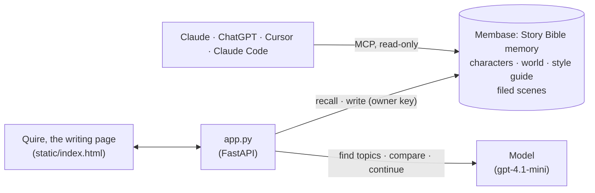
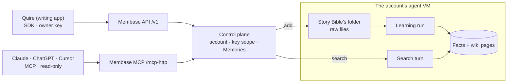

# Story bible

*Quire* is a novelist's writing app. On the left, the binder holds the canon of *Saltmarrow*, an
original city built inside the skeleton of a beached leviathan: its characters, places, world
rules, style guide and finished scenes. That canon lives in a Membase Memory called
`Story Bible`. In the middle is the manuscript page. **Check continuity** turns every sentence
that breaks canon into a comment in the margin, quoting the canon line it breaks, with a fix you
accept like a suggestion. **Continue** writes the next paragraphs from recalled canon.
**Add to canon** files the finished scene in the binder: one write to the Memory. Every AI
connected to that Memory reads the same canon: Claude, ChatGPT, Cursor or Claude Code.

**Base:** hosted Membase by default, because the point is that the same Memory is shared across
tools. Set `MEMBASE_DEMO_MODE=local` to run the page alone, with nothing leaving the machine.

## Video

https://github.com/user-attachments/assets/c7a67370-2ec0-4abe-bc95-5227ef8b5f27

70 s · hosted Membase and the real Claude Code. After a short explainer of how the app and Membase fit together:

1. **The canon lives in memory.** Quire's binder lists the Saltmarrow canon. Chapter Three is a
   draft with planted mistakes.
2. **Check continuity.** Three sentences are highlighted on the page: the red wine, the compass
   settling on north, and Tobiah coming in "without whistling". Each margin comment quotes the
   canon it breaks ("she drinks bitter kelp tea, black, from a dented tin cup") and suggests a
   fix. **Accept all** applies them.
3. **Continue from canon.** New prose appears in green, written only from recalled canon and the
   style guide (kelp tea, the tide-bells); the margin lists the canon notes it drew on. **Keep**
   adds it to the chapter.
4. **Add to canon.** The scene is filed in the binder: one write, then the hosted memory learns
   it and the binder says *in canon*.
5. **Another AI reads the same canon.** Claude Code, connected only to Membase's MCP with a
   read-only key and its own memory off, answers "a small iron key stamped 41 … Corin's locker
   on the third Rib Bridge": a detail only the new scene has.

The take is kept only if the check leaves the key, the locker and the bridge alone (they are
the scene's new facts, not contradictions), the scene is learned, and Claude's answer has the 41.

## How it works

The app keeps no database of its own. The bible and the filed scenes live in the `Story Bible`
memory. A model compares, writes, and names scenes, using only the passages memory returns.



| What | Where it lives | Written by | Read by |
|---|---|---|---|
| The bible: characters, places, world rules, style guide, two scenes (`bible/`) | `Story Bible` memory, one document | `seed.py` | every check and continuation, and any connected AI |
| Filed scenes | `Story Bible` memory, one document per scene | **Add to canon** | the next check and continuation, and any connected AI |
| The binder's names (characters, places, rules, scenes) | the same `bible/` files | you | `GET /api/binder`, for the page to list; no model call gets them |

The page has the binder on the left, the manuscript page in the middle and comments in its
margin. The steps:

| Step | What happens | Membase call | Model's job |
|---|---|---|---|
| **1 · Canon in memory** | The bible is already in the memory; the binder says "Canon in memory" once it is learned. | `add_document` (seed) | none |
| **2 · Check continuity** | The chapter's topics are recalled. Every sentence that contradicts a passage is highlighted, and its margin comment quotes the line of the cited passage that it breaks (binder entries the recall touched get a dot). **Accept** or **Accept all** rewrites the sentence. | `search` | name the chapter's topics ("Ilse's drinking habits"); find contradictions that cite a numbered passage (uncited ones are dropped) |
| **3 · Continue** | The topics and the style guide are recalled, then up to 120 words are written in the bible's voice, in green on the page. **Keep** adds them to the chapter. | `search` | continue using only the recalled facts and style |
| **4 · Add to canon** | The scene is written once and appears under *Scenes* in the binder. Once Membase has learned it, it says *in canon*. | `add_document` (one per scene; the same text twice is one document) | give the scene a title |

The search is asked about the draft's **topics** ("the compass's needle"), never the draft
itself: what is checked is the draft, and what it is checked against is only the bible.

## How Membase serves it



- **One Memory, two doors.** The writing app uses the REST API with a developer key that can
  write. Chat apps and agents use MCP, the same tools on another wire, with a connection that
  can only read: `list_containers`, `search_memories`, and `get_profile` if granted. A write
  key is not needed to read canon.
- **A write becomes canon only after learning.** **Add to canon** puts the scene in the
  Memory's folder and returns at once. A learning run in the account's agent VM then reads it
  into facts. Until that run finishes, neither the page nor a connected AI can find it, so the
  binder shows "learning…" and waits. Each write waits for the previous learning run to finish.
- **Every search is a recall turn** in that VM. It returns passages that cite the page they came
  from. A warm search takes 5–16 s.
- **On the local engine** the same calls are answered in-process by `unibaseio-membase-core`. The bible
  becomes a topic tree in SQLite and FAISS, a scene can be searched as soon as it is written,
  and no other AI can reach it, unless you run `membase --local mcp` on the same machine.

## Use it

```bash
uv sync                                  # once, at the repo root
cp .env.example .env                     # OPENAI_API_KEY; MEMBASE_API_KEY for hosted
uv run 04-story-bible/seed.py            # the bible in, and waits until it is learned
uv run 04-story-bible/app.py             # open http://127.0.0.1:8704
```

**Hosted.** In the Membase app, create a Memory named `Story Bible` and a developer key that can
write, and put it in `.env`. To try the MCP side, also create a key that can only read.

Then, on the page:

1. Chapter Three opens with planted mistakes. Press **Check continuity**. Each contradiction is
   highlighted on the page, and the comment beside it says what canon says instead, quotes the
   canon line, and suggests a fix. The planted mistakes are the wine (Ilse drinks only kelp tea), a
   compass pointing north (it points to the leviathan's heart), the words "suddenly" and "the
   sea" (the style guide forbids them inside the city). The check does not always catch every
   one of them.
2. Press **Accept all**, then **Continue**. Look for details only the bible has, such as kelp
   tea, the tide-bells or "Hm". Press **Keep**.
3. Press **Add to canon** and wait until the new scene in the binder says *in canon*. The
   scene's new fact (Tobiah gives Ilse an iron key stamped 41, for Corin's locker on the third
   Rib Bridge) is now canon.
4. Ask another AI. **Canon in other AIs**, at the bottom of the binder, shows the MCP address.
   **Drafts** in the toolbar switches to a clean opening.

### From Claude Code, with a read-only key

```bash
cat > mcp.json <<EOF
{"mcpServers": {"membase": {"type": "http", "url": "$MEMBASE_BASE_URL/mcp-http",
  "headers": {"Authorization": "Bearer $MEMBASE_READ_KEY"}}}}
EOF
claude -p --mcp-config mcp.json --strict-mcp-config \
  --allowedTools=mcp__membase__search_memories \
  "In my Saltmarrow story, what did Tobiah give Ilse, and what does it open? Look it up in my Membase memory."
```

The answer comes from the filed scene: an iron key stamped 41, for Corin's locker on the third
Rib Bridge. The video turns off Claude Code's own auto-memory
(`CLAUDE_CODE_DISABLE_AUTO_MEMORY=1`), so the only memory it has is Membase.

### From Claude or ChatGPT

The connector address is `https://api.app.membase.ai/mcp-http`.

- **Claude** (claude.ai and the desktop app): open **Customize → Connectors → + → Add custom
  connector**, paste the address, tick **Story Bible** on Membase's consent screen, and press
  **Approve access**. In a chat, switch Membase on under **+ → Connectors**.
- **ChatGPT:** open `https://chatgpt.com/plugins`, press **+**, and choose the public MCP server
  connection with the full `/mcp-http` address and **OAuth** (leave Client ID and Secret empty).
  Tick **Story Bible** on the consent screen and press **Approve access**. Developer mode may be
  needed, and it requires a paid plan.

A chat-app connection only reads, and only sees the Memories you switched on. New canon comes in
through this page, or through an agent holding a key that can write.

## API

| Endpoint | Does |
|---|---|
| `GET /api/canon` | Lists the documents in the memory with their learning state. |
| `POST /api/check` | Takes `{text}`. Recalls the draft's topics and streams the passages, then the cited contradictions. |
| `POST /api/continue` | Takes `{text}`. Recalls the topics and the style guide and streams the continuation. |
| `POST /api/accept` | Takes `{text}`. Writes the scene once and waits its turn behind a running learning run. |
| `GET /api/binder` | The binder's names, from the `bible/` files. |
| `GET /api/connect` | Returns the MCP address another AI can use. |

`smoke.py` runs the loop on a hosted account: it seeds the bible, catches a planted
contradiction with a citation, finds a bible-only detail in a continuation, and checks that an
accepted scene is learned and then recalled. The bible in `bible/` is original fiction written
for this demo.
