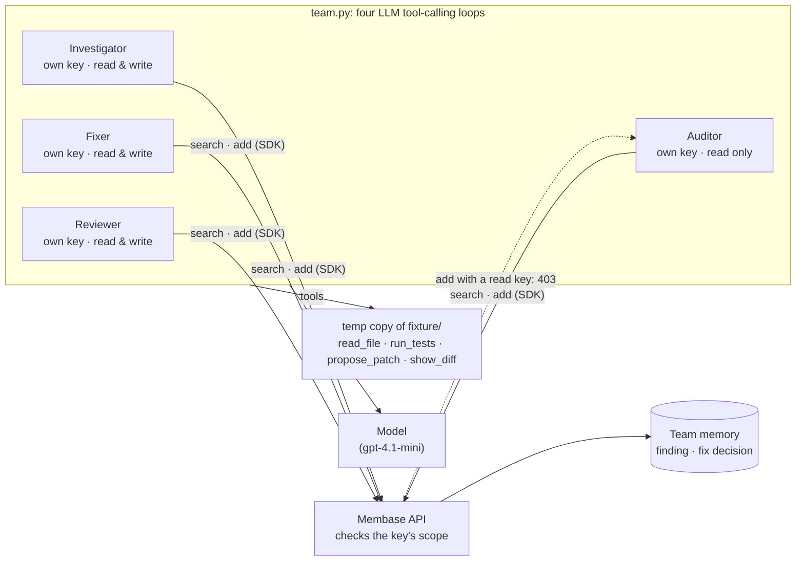
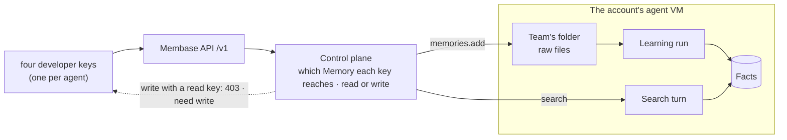

# Agent team

Four agents fix a real bug together through one shared Membase memory, and each one calls
Membase with its own key. The page is an issue tracker: the agents are the team's members, the
issue's timeline shows what each one did, and the shared memory is the team's pinned notes. The
Investigator finds the cause and pins it. The Fixer recalls that finding before it opens a file,
then patches the bug and records its decision. The Reviewer recalls both, reads the diff and runs
the tests. The Auditor holds a read-only key: its search works, but Membase refuses its write with
`403`, and the timeline shows the refusal as it came back.

The bug is real code. `fixture/` is a small token-bucket rate limiter whose refill counts time
since creation instead of since the last refill, so a long-running process lets too many
requests through (`ISSUE.md`). Two tests fail on the original code and pass once the bug is
fixed.

**Base:** hosted. Keys and their access levels exist only on hosted Membase.

## Video

https://github.com/user-attachments/assets/f2acd4fd-f9a7-4b98-b635-babc861c24b0

60 s · hosted Membase, one key per agent. After a card that shows how the app and Membase fit together:

1. **The Investigator finds the cause.** ISSUE-212 is assigned to the agent team. The Investigator reads the code, the tests fail (a red check), and it pins one finding to the Team notes.
2. **Membase learns it** before the next agent can find it (58 s, sped up). The pinned note turns *learned*.
3. **The Fixer recalls it first.** Its first entry on the timeline quotes the Investigator's note as Membase learned it, and the note in the sidebar is marked *recalled by the Fixer*. Then one line changes and the check turns green.
4. **The Reviewer checks it** and approves the fix, citing what memory said.
5. **A read-only key cannot write.** The Auditor's search works; its note is refused, and the timeline shows Membase's `403` as it came back.

## How it works

The app keeps no memory of its own. The agents hand work to each other only through the `Team`
memory, and Membase decides what each key may do.



| Agent | Its key | Memory calls | Other tools | Leaves behind |
|---|---|---|---|---|
| **Investigator** | own, read & write | `add_memory` once | `list_files`, `read_file`, `run_tests` | one finding: file, function, faulty line, the test that shows it |
| **Fixer** | own, read & write | `search_memories` first, then `add_memory` once | `read_file`, `propose_patch`, `run_tests` | the patch, and one decision: what changed, why, the test result |
| **Reviewer** | own, read & write | `search_memories` | `show_diff`, `read_file`, `run_tests` | a verdict citing what memory said |
| **Auditor** | own, **read only** | `search_memories` works; `add_memory` is refused (`403`) | none | nothing, because it cannot write |

The page is the issue, ISSUE-212, in a small issue tracker. Each agent is a member with its own
avatar and key; what it does lands on the issue's timeline: files read, test runs as checks, the
note it pinned, what it recalled, its patch, its review. The sidebar holds the Team notes (what the
`Team` memory holds, and whether each note is learned yet), the checks, and each member's key.

## How Membase serves it



- **Keys are the permission boundary.** Each key belongs to the account, reaches the Memories it
  was given (here `Team`), and has a level: read, read & write, or full. Membase checks it on
  every call, not `team.py`. Revoke or narrow one agent's key in **Connect › Developer keys**,
  and that agent stops at its next call while the others carry on. The read key's write comes
  back as `{"code": "unauthorized", "message": "token missing required scope", "details":
  {"need": "write"}}`.
- **A hand-off waits for learning.** `memories.add` puts the agent's memory in the Team folder and
  returns at once. A learning run in the account's agent VM then turns it into facts, and only
  after that can the next agent's search find it. So after each write the run polls the document
  until its learning run ends (35–70 s), and the page shows that wait. Writes go one at a time.
- **Search is a recall turn** in the same VM. The Fixer's first call is a search, and the page
  shows what it recalled before the Fixer opens any file.
- **Over MCP, a read key never sees a write tool.** The same keys work as MCP bearer tokens. A
  read key's `tools/list` leaves out `add_memory`, so a CLI agent holding it cannot even try to
  write (see "The same with real CLIs" below).

## Use it

```bash
uv sync                          # once, at the repo root
uv run 05-agent-team/app.py      # open http://127.0.0.1:8705
```

In the Membase app, create a Memory named `Team`. Then, under **Connect › Developer keys**,
create one key per agent that reaches it: *Read & write* for the Investigator, Fixer and
Reviewer, and *Read* for the Auditor. Put them in `.env` as `MEMBASE_KEY_INVESTIGATOR`,
`MEMBASE_KEY_FIXER`, `MEMBASE_KEY_REVIEWER` and `MEMBASE_KEY_AUDITOR`. Without per-agent keys,
the writers share `MEMBASE_API_KEY` and the Auditor uses `MEMBASE_READ_KEY`.

Then press **Assign to the agent team** and watch the timeline:

1. **The Investigator** picks the issue up with its own key, reads `ISSUE.md` and the code, runs
   the tests (a red check), and pins one finding. The yellow note is the exact text written to
   memory.
2. **Membase learns it.** A timeline line counts the wait; the note in **Team notes** turns
   *learned*.
3. **The Fixer** looks in the Team notes first. Its entry quotes what it recalled, the
   Investigator's finding, and the sidebar marks that note *recalled by the Fixer*. Then come its
   one-line diff and a green check.
4. **The Reviewer** recalls the finding and the decision, reads the diff, runs the tests, and
   approves or requests changes.
5. **The Auditor**, whose key is read only, searches (that works), then tries to pin a note. The
   red entry is Membase's `403`.

One run makes two writes and takes 2–5 minutes. The agents use `DEMO_MODEL` (default
`gpt-4.1-mini`); set `TEAM_MODEL` to give them another. If an agent stops before doing its job,
the run reminds it, at most twice, and shows each reminder.

## The same with real CLIs

Two coding agents can share one Memory, each with its own key. Here Claude Code can write and
Codex can only read.

```bash
# Claude Code: a key with Read & write
claude mcp add --transport http membase https://api.app.membase.ai/mcp-http \
  --header "Authorization: Bearer $MEMBASE_KEY_FIXER"

# Codex: a Read key
codex mcp add membase --url https://api.app.membase.ai/mcp-http --bearer-token-env-var MEMBASE_KEY_AUDITOR
```

Ask Claude Code to *"investigate ISSUE-212 and record the root cause in the Team memory"*. Once
the finding is learned, ask Codex to *"search the Team memory for ISSUE-212 and add an audit
note"*. Codex finds the finding but cannot add the note. A real `codex exec` with the
read key was offered only the read tools and answered *"There is no tool called add_memory
available"*. For automatic recall and saving in each CLI, add the hooks from
[01-coding-memory](../01-coding-memory/).

## API and files

| Endpoint | Does |
|---|---|
| `POST /api/run` | Runs the four agents and streams the timeline: `run` (keys), `agent`, `tool`, `say`, `note`, `wait`, and `done` (verdict, writes). One run at a time. |
| `GET /api/feed` | Lists what the Team memory holds and whether each item is learned. |
| `GET /api/fixture` | Returns the repository the agents work on. |

- `team.py`: the agents, their tools, the learning waits and `run()`
- `fixture/`: `ISSUE.md`, `ratelimit/`, `tests/`
- `smoke.py`: the whole run against the real API. It checks that the finding was written, that
  the Fixer's search returned it, that the Reviewer gave a verdict, and that the Auditor's write
  was refused with `403`.
