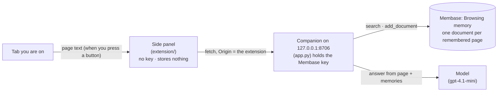

# Browser memory

This demo asks your memory about the page you are on. A Chrome side panel, *Browser Memory*,
reads the open page. **Remember** saves it to a Membase Memory called `Browsing`. Later, on any
page, a question in the panel's ask box is answered from that page and from what you remembered,
and each recalled fact is linked to the page it came from.

The concrete case: one day you read the trail notes for a hike and a review of a backpack, and
you remember both. A few days later you open the weekend forecast and ask which day to go and
what to bring. The answer picks the day from the forecast, takes the only water stop and the
18:00 gate from the trail notes, and the missing rain cover from the pack review.

**Base:** hosted Membase. The pages in `pages/` are fictional.

## Video

https://github.com/user-attachments/assets/08b56a06-9545-486e-819c-54fa5c842ad0

64 s · hosted Membase, the real Chrome extension, docked beside three fictional sites. After a card that shows how the app and Membase fit together:

1. **Remember pages you read.** A trail guide (*Fernwick Trail Journal*) and a pack review (*Kitbag Weekly*): one click on **Remember** in the side panel for each.
2. **Membase learns them** (54 s, sped up). Under **Remembered pages**, both turn *Learned*.
3. **Days later, on the forecast, ask** which day to go and what to plan for water and gear. The answer picks Sunday from the forecast on screen, the one water stop from the trail notes, and the missing rain cover from the review, with numbered citations.
4. **Every fact says where it came from.** Under **From your memory**, the memories the answer used come first, each with the favicon and title of the page it was saved from.

## How it works

There are three parts, and only one of them holds the key.



| Part | Holds | Does |
|---|---|---|
| **Side panel** (`extension/`, Chrome MV3) | nothing: no key, no `chrome.storage` | reads the open tab's title, URL, selection and text; calls only the companion |
| **Companion** (`app.py`, on 127.0.0.1) | the Membase developer key | answers only the extension, only on loopback; searches and writes Membase; asks the model |
| **Membase · `Browsing` memory** | every remembered page, learned into facts | recall, with each fact citing the page it came from |

The panel is drawn like Chrome's own side panels: the page you are on with a **Remember**
button, an ask box, the answer with its citations, and the pages you have remembered with their
learning state.

| Button | Companion endpoint | Membase call | Model's job |
|---|---|---|---|
| **Remember** | `POST /api/remember` | `add_document` with the page's text, URL, title and favicon URL (the same URL twice is one document) | none |
| **Ask** (the ask box) | `POST /api/ask` | `search` with the question, the page title and any selection, but not the page text | answer from the page plus the numbered memories, citing each one used |

## How Membase serves it

- **The key never reaches the browser.** This follows a platform rule: browser code must not hold
  a Membase bearer token in storage that JavaScript can read. The companion keeps it server-side.
  Revoke or narrow that key in **Connect › Developer keys**, and the panel stops working on its
  next call.
- **The companion answers only the extension.** A request whose `Origin` is not the extension
  (`chrome-extension://lhojclgfedbhfpkjklfgjgnikckelabe`, fixed by the manifest's `key`) or the
  companion's own page gets `403`. A `Host` that is not loopback also gets `403`, which stops
  DNS-rebinding pages. Local command-line tools send no `Origin` and are let through, like any
  process that could read `.env` anyway.
- **A remembered page is recalled only after learning.** `add_document` puts the page in the
  Memory's folder and returns at once. A learning run in the account's agent VM then reads it
  into facts. The panel shows *learning*, then *learned* (about a minute per page). Pages are
  written one at a time, so the next page shows *waiting* until it can go.
- **Search is a recall turn**, and only the question goes into it: memory is searched for what
  you asked, and the page you are on goes only to the model.
- **Every fact says which page it came from.** Hosted hits carry no document id, only a
  `[[link]]` the learning run named. The companion matches the link to the remembered page by its
  `custom_id` or title, and shows "from *page title*".

## Use it

```bash
uv sync                                                  # once, at the repo root
uv run 06-browser-memory/app.py                          # http://127.0.0.1:8706
python -m http.server 18706 -d 06-browser-memory/pages   # the three fictional pages
```

In the Membase app, create a Memory named `Browsing` and a developer key that can write, and put
the key in `.env` as `MEMBASE_API_KEY`.

Then load the extension:

1. Open `chrome://extensions` and switch on **Developer mode**.
2. Click **Load unpacked** and choose `06-browser-memory/extension`. The ID shown must be
   `lhojclgfedbhfpkjklfgjgnikckelabe`. If you repack the extension under another ID, set
   `BROWSER_MEMORY_EXTENSION_ID`.
3. Pin the extension and click its icon. The side panel opens beside the tab.

And try it:

1. Open `http://127.0.0.1:18706/larchmere-ridge-loop.html` and press **Remember** in the panel. Do
   the same on `corvid-38-review.html`.
2. Wait until **Remembered pages** shows both as *Learned*.
3. Open `larchmere-forecast.html` and ask: *"I want to hike the loop I saved this weekend,
   carrying the pack I read about. Which day should I go, and what do I need to plan for water
   and gear?"*
4. Read the answer, then **From your memory**. The memories it cited come first, each linked to
   the page it came from. The rest are folded away.

On sites other than localhost, the panel asks once, through Chrome's own permission prompt, to
read pages. Your Memory gets a page only when you press **Remember**.

## Files

- `app.py`: the companion. It serves `/api/ask` (server-sent events), `/api/remember` and
  `/api/pages`, plus a setup page at `/`.
- `extension/`: `manifest.json`, `background.js` (the icon opens the panel), and
  `panel.html`, `panel.js` and `panel.css`, with `icons/` and `fonts/` (Google Sans, from Google
  Fonts, so the extension loads nothing from the network). `demo.html` and `demo.js` form the
  Chrome-like window the video is recorded in: the real page on the left and the real panel on
  the right, reading a real tab that has the same URL. Normal use does not need them.
- `pages/`: the three fictional sites, each with its own favicon.
- `smoke.py`: runs the whole flow through the companion. It checks that a foreign origin and a
  non-loopback host are refused, remembers two pages and waits until they are learned, then asks
  on the third page and checks that the answer cites both.
- `extension_check.py`: drives the real extension in Chromium, with the docked side panel opened
  by a real click, and saves `docs/screenshot.png`.
