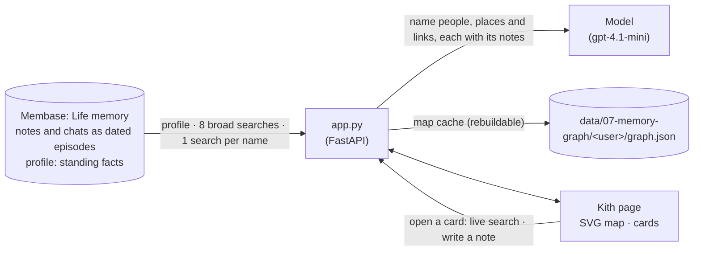

# Memory graph

*Kith* is a notes app with a map: the people, places, projects, events and organisations in
your notes, and how they connect. The map is drawn from what a Membase memory returns. Open any
person or place and its card lists the notes it came from, each with its date. Write a new note
and rebuild, and everything the note touched glows.

The notes belong to Lena Varga, an invented product designer in Lisbon: four months of notes
and chats about a new job at Northwind Labs, a banking-app project for Harbor Bank, the people on
it, a talk in Berlin, climbing with a friend, and her sister's wedding. In the video Lena writes
one note, *"Clara Jensen told me she is moving to Harbor Bank's new Porto office in January…"*.
After a rebuild, Clara, Harbor Bank and Porto glow on the map, with the new links between them,
and Clara's card opens with today's note.

**Base:** the local engine by default, with one directory per person (`?user=<name>` on the
page). Set `MEMBASE_DEMO_MODE=hosted` to use hosted Membase.

## Video

https://github.com/user-attachments/assets/91e57c45-2314-4a9b-ab95-3acae386e25d

58 s · local engine. After a card that shows how the app and Membase fit together:

1. **Build the map from memory.** Kith reads Lena's memory: what she always keeps, eight broad
   questions, then every name those turn up. People are round avatars, places are pins, projects
   are folders, events are diamonds, organisations are hexagons.
2. **Every person keeps her notes.** Search *Clara Jensen*: her card shows her role, her links
   (works at Harbor Bank, sponsor of Atlas) and the dated notes she came from, with her name
   marked. A live search checks memory for anything newer.
3. **Write one new note:** *"Clara Jensen told me she is moving to Harbor Bank's new Porto office
   in January, and she wants me to visit the team there in February."*
4. **Rebuild.** Clara, Harbor Bank and Porto glow, the new links run as dashed gold lines, and
   *New since last build* lists them. Clara's card now opens with today's note.

## How it works

There is no call that lists every memory, so the map is built from what memory returns.



| What | Where it lives | Written by | Read by |
|---|---|---|---|
| Lena's 14 notes and chats, each dated by the day it happened | `Life` memory, as episodes | `seed.py` | the profile and every search |
| Three standing facts ("Lives in Lisbon…") | the profile | `seed.py` | every build (shown as *Standing fact*) |
| A note written on the page | `Life` memory, dated today | **Save note** | the next build; the cards' live search |
| Which memories each note became, and the note as Lena wrote it | `notes.json` in the person's directory | `seed.py`, **Save note** | the page, to show her own words for a recalled passage |
| The map: people, places, links, and the notes each came from | `graph.json` in the person's directory | each build | the page |

The page has three parts: on the left whose notes these are, what kinds of thing are on the map
(click one to hide it) and the notes, newest first; the map in the middle; a card on the right.

| Step | What happens on the page | Membase call | Model's job |
|---|---|---|---|
| **1. Build** | *Build the map* (later *Rebuild map*). The empty map shows four steps as they run: what you always keep, eight broad questions, following every name, drawing. | `profile`, then `search` 8 times, then once per name found (up to 24) | find the names worth searching; then name people, places, projects, events and organisations and the links between them, each with the numbers of the notes that state it |
| **2. Open a card** | Search a name or click a node. Its links light up and the rest dims. The card shows the node's role, its connections and *From Lena's notes*: every note it was built from, dated, in Lena's own words, starting at the sentence that names it, with the name marked. Hover a note to see the passage memory returned for it. Above them, a live search says whether memory holds anything newer on that name. | `search` on the name | none |
| **3. Write a note** | Back on *Today*, write a note and press **Save note**. It is listed under the box as *not on the map yet*, and **Rebuild map** shows *1 new*. | `memories.add` | none |
| **4. Rebuild** | The map is built again. A node or link that cites a note the last build did not have glows, and *New since last build* lists them. The new note leads the cards it touched, marked *new since last build*. | as step 1 | as step 1 |

Anything without a note behind it is dropped: an entity or link the model names without citing
a passage never reaches the map. The map is a cache, never a second copy of the memory. Delete or
correct a note, rebuild, and whatever came from it changes. Each build names things afresh, so
link labels can change wording between builds; that is why "new" is decided by notes, not by
labels.

## How Membase serves it

- **Local engine.** `Membase(local=data/07-memory-graph/<user>)` answers the SDK calls in the
  app's process with `membase-core`. Each directory is one person's memory, which is how an app
  on the local engine keeps its users apart.
- **Dated notes.** `seed.py` writes each note as a session dated by the day it happened (through
  `demokit.dated`, the same engine call `memories.add` makes with the date given instead of now).
  The engine turns each into episodes, and a search returns each episode with its session date.
  That date is what a card shows. A note saved on the page goes through `memories.add`, so it is dated
  today.
- **Notes in her own words.** Every write returns the ids of the memories it became, and the
  app records them with the note as Lena wrote it (`notes.json`). A search hit carries its id
  (`source`), so the page shows the note she wrote for each passage recalled. The map is built
  from the passages.
- **Search and profile.** A search is hybrid keyword and vector retrieval over the episodes. The
  profile returns the standing facts plus the most recent episodes. A new note can be searched as
  soon as the write returns (about 5 s), so a rebuild can follow right away.
- **Hosted.** The same calls go to the account's `Life` Memory. A write is learned by a learning
  run before search can find it (about a minute), and a search is a recall turn in the account's
  agent VM; prose about what it did not find is dropped. The hosted profile has no "recent
  memories" list, so the map comes from the searches alone, and a card dates a note only when
  the recalled fact starts with its date.
- **What the map cannot show.** Anything memory never returns for these searches is missing.
  *How this map was made*, at the bottom left, lists every search that ran.

## Use it

```bash
uv sync                                  # once, at the repo root
uv run 07-memory-graph/seed.py           # about 15 s on the local engine: 14 notes, 3 facts
uv run 07-memory-graph/app.py            # open http://127.0.0.1:8707
```

Then, on the page:

1. Press **Build the map**. The four steps tick off; a build takes 1–1.5 minutes. The map
   appears with Lena in the middle.
2. Type *Clara Jensen* in the search box and press Enter. The map centres on her and dims the
   rest. The card shows *Harbor Bank head of digital channels*, her connections, and five dated
   notes with "Clara" marked.
3. Press **← Today**. Write a note about someone on the map and press **Save note**. It appears
   under the box as *not on the map yet*; **Rebuild map** shows *1 new*.
4. Press **Rebuild map**. The nodes and links the note touched glow, and *New since last build*
   lists them. Click one: its card opens with your note.

**Hosted.** Create a Memory named `Life` and put a developer key in `.env`. The seed script
writes one note at a time and waits for each one to be learned.

## API

| Endpoint | Does |
|---|---|
| `GET /api/graph?user=` | The cached map, or `null`, and whose notes these are. Each passage has its date, its memory id and, when the app wrote it, `note`: the note as Lena wrote it. |
| `POST /api/graph/rebuild` | Takes `{user}`. Recalls, names people, places and links, and caches the result. Streams each step, then the map. |
| `POST /api/recall` | Takes `{name, user}`. A live search on one name; each hit has its date and `note`. |
| `POST /api/remember` | Takes `{text, user}`. Writes one note. |

`smoke.py` seeds a fresh store and builds the map. It checks that every seeded person, place,
organisation and project is there with a note that names it, that at least two seeded links are
present, that the notes carry the days they happened, and that each passage maps back to the
note Lena wrote.
