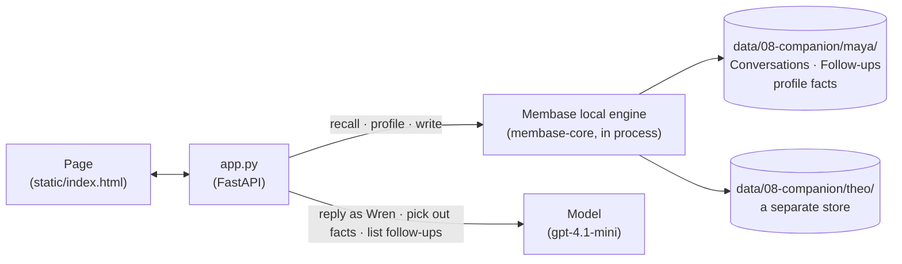

# Companion

*Night Line* is the listener line of a late-night radio show. Wren, an original character, hosts
*Saltmarsh After Dark* on 98.4 FM in a small harbour town, and you call in from a phone-style
chat. Maya, a product designer, tells Wren she has a job interview at Brightwater Studio on
Thursday and is nervous about the portfolio review. Wren signs off and jots in her notebook what
to ask next time. When Maya calls again, Wren speaks first and asks about the interview, and the
note she recalled is pinned under her message. Then Theo, a night-shift nurse, calls on his own
line. His notebook page is empty, because his memory is a different directory: Wren has no
memory of an interview, or of Maya.

This is the same kind of app as an AI companion or a Live2D character with memory: one character,
many people, and each person's memory kept apart. Wren's notebook on the page *is* the caller's
memory: what she knows is the profile, what she means to ask is the follow-ups.

**Base:** the local engine by default, one directory per person (`data/08-companion/<person>/`).
Hosted mode runs, but a hosted account is one person, so Maya and Theo would share it.

## Video

https://github.com/user-attachments/assets/7f218dbe-3271-449c-b340-16121c242262

57 s · local engine, one directory per person. After a card that shows how the app and Membase fit together:

1. **Maya calls in.** She tells Wren about Thursday's interview at Brightwater Studio and her
   nerves about the portfolio review. Wren answers in two or three sentences.
2. **Wren signs off.** The phone goes off air; her notebook page for Maya fills in: what she
   knows (Maya has a cat named Miso), that she called today, and under *ask next time* the
   interview.
3. **Next call: Wren asks first.** She opens with the interview, and a slip from her notebook
   under her message shows the follow-up she recalled from Maya's memory.
4. **Theo's line.** His notebook page is blank. Asked about "my job interview", Wren says she
   has no memory of one. Afterwards his page holds only what he said on this call, such as his
   name.

## How it works



The app opens one Membase client per person: `Membase(local="data/08-companion/maya")` for Maya
and `.../theo` for Theo. Each is its own store, so nothing one person says can be recalled for
the other. This is how an app on the local engine keeps its users apart.

| What | Where it lives | Written by | Read by |
|---|---|---|---|
| Each finished call | the person's `Conversations` memory, as episodes | **Sign off** | every reply's recall; the next call's opener |
| Follow-ups, one line each in Wren's notebook voice, e.g. "Maya: job interview at Brightwater Studio, Thursday 2026-10-15, nervous about the portfolio review." | the person's `Follow-ups` memory, one memory each | **Sign off** | the next call's opener; *ask next time* in the notebook |
| Which memories each follow-up became, and the line as Wren wrote it | `notebook.json` in the person's directory | **Sign off** | the slip under the next opener |
| Standing facts, e.g. "Maya has a cat named Miso." | the person's profile | the app, after each exchange | every reply; *knows* in the notebook |
| Wren's persona and boundaries | `app.py` (the prompt) | — | the model |

The page has three parts: the show and who is on the line on the left, the call in a phone in
the middle, and Wren's notebook page for the caller on the right.

| Step | What happens | Membase call | Model's job |
|---|---|---|---|
| **1. Call in** | Before each reply, the message is searched in the person's memory and the profile is read; both go into Wren's prompt. After the reply, the lasting facts in the exchange go to the profile, in the background. | `search`, `profile`, then `memories.add(static=True)` | reply as Wren; pick out standing facts |
| **2. Sign off** | The phone goes off air and the call is written once. The model lists the open loops, with relative dates made absolute ("Thursday" becomes "Thursday 2026-10-15"), and each one is written as its own follow-up memory. The notebook shows them under *ask next time*, with a pencil while the writes run; *In her notebook* means they are written and searchable. | `memories.add` into `Conversations`, then into `Follow-ups` | list the open loops |
| **3. Tune in again** | The app waits for any writes still running, then recalls follow-ups and the last conversation, and reads the profile. Wren speaks first with one follow-up, checked against today's date: ask how it went, or wish luck if it is still ahead. A slip *from her notebook* under the opener shows the follow-up she recalled, as she wrote it, with the day she wrote it. | `search` on `Follow-ups` and `Conversations`, `profile` | write the opener |
| **4. Another line** | Click Theo under *On the line tonight*. The notebook turns to his page, which is blank: his directory is empty, so recall returns nothing and Wren introduces herself. | the same calls, on Theo's directory | — |

Wren's voice and boundaries are part of her prompt. Replies stay at two or three short
sentences. She says she is an AI if asked, she does not act as a therapist or doctor, she does
no romantic roleplay, and she never makes up a memory. The page says she is an AI character.

## How Membase serves it

- **The local engine runs in the app.** `membase-core` answers the SDK calls in the app's own
  process. Nothing leaves the machine except the model calls the engine makes with your
  `OPENAI_API_KEY` (to extract and embed).
- **One directory per person.** Each directory holds its own SQLite and FAISS files. The engine
  turns a written conversation or follow-up into timestamped episodes, and `static=True` facts
  into the profile.
- **A write is searchable in seconds.** A local write takes 5–8 s, and its episodes can be
  searched as soon as it returns; there is no learning run. The app runs writes in the
  background, one person at a time and in order (`demokit.writes.BackgroundWriter`). The notebook
  shows a pencil while writes run, and a new call waits for them before it recalls.
- **The slip shows Wren's own line.** The write returns the ids of the memories it became, and
  the app records them with the line Wren wrote (`notebook.json`). A recalled hit carries its
  id, so the slip under her opener shows that line.
- **Search** is hybrid keyword and vector retrieval over the person's episodes. Recall takes
  1–3 s once the engine is loaded.

## Use it

```bash
uv sync                          # once, at the repo root
uv run 08-companion/app.py       # open http://127.0.0.1:8708
```

The first message loads the engine for that person, which takes a few seconds.

Then, on the page:

1. The phone shows Maya's line, on air. Wren introduces herself and asks your name. Tell her
   about something coming up: "Hi Wren, I'm Maya. I have a job interview at Brightwater Studio
   on Thursday and I'm nervous about the portfolio review. Miso, my cat, kept me company." Wren
   replies; in the notebook, *knows* fills with facts such as "Maya has a cat named Miso."
2. Press **Sign off** at the top of the phone. *Wren signed off*; the notebook adds that she
   called today and, under *ask next time*, the interview. Wait for *In her notebook. She'll remember.*
3. Press **Tune in again**. Wren opens with the interview, and under her message a slip *from
   her notebook* shows the follow-up she recalled.
4. Click **Theo** under *On the line tonight*. His notebook page is blank and Wren introduces
   herself. Ask "Do you remember my job interview?" and she says she doesn't.

## API

| Endpoint | Does |
|---|---|
| `GET /api/users` | The two people, each with their directory and writes in flight, and Wren's persona. |
| `GET /api/memory?user=` | A person's profile facts, their containers, and writes in flight (for the notebook). |
| `POST /api/chat` | Takes `{user, message, history}`. Streams what was recalled, then Wren's reply. |
| `POST /api/end` | Takes `{user, history}`. Writes the conversation and returns the follow-ups it wrote. |
| `POST /api/open` | Takes `{user}`. Waits for writes, recalls follow-ups, and streams Wren's opener. |

`smoke.py` runs the whole story on a fresh data directory: Maya mentions the interview, the
session ends with a follow-up for it, the next opener recalls it and brings it up, the profile
holds her cat, and Theo's Wren recalls nothing and knows neither Brightwater nor Miso.
