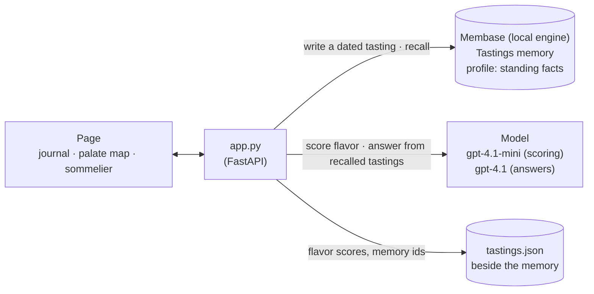

# Taste journal

Sam, an invented taster, keeps a tasting journal in an app called *Pour*: every coffee, tea and
wine, with notes in his own words and a rating. Each tasting is a memory, an entry in the journal
and a dot on a palate map where things that taste alike sit together. Memory holds five months
of tastings, from a Beaujolais Fleurie he loved in June to a Barossa Shiraz he rated 2 of 5 in
July. In the video Sam adds tonight's wine, an Etna Rosso he loved, then asks the app's sommelier
for *"a red for Friday dinner"*. The sommelier's note suggests three light reds, such as Frappato
and Trousseau, and cites Sam's own entries by number: tonight's Etna and the Fleurie, which he
loved, and the heavy reds he didn't. The same numbers light up on the map and in the journal.

**Base:** the local engine, with one directory per person (`data/09-taste-journal/sam/`). Each
tasting is dated by the day it was tasted, which needs the local engine.

## Video

https://github.com/user-attachments/assets/a1ba47b6-8b37-4ce2-a104-bf6c0c3109ee

70 s · local engine. After a card that shows how the app and Membase fit together:

1. **Sam adds tonight's wine.** Etna Rosso, Mount Etna, 2022, in his own words, rated 5 of 5. A wine label draws itself as he types. It lands at the top of the journal and as a dot on the palate map.
2. **It joins five months of tastings.** Hovering two dots opens their journal pages: a Fleurie he loved, a Barossa Shiraz he rated 2 of 5. Seconds later the new entry says *remembered, for the sommelier*.
3. **Sam asks: a red for Friday dinner?** Memory returns the 13 tastings that bear on it. The rest of the map and the journal fade.
4. **The note cites his own entries.** Three suggestions in a sommelier's voice, each citing the entry it is like and the one it avoids. The numbers are on the map and in the journal; hovering one opens that entry.

## How it works

The recommendation comes only from what memory recalls. The map draws every tasting, and during
an answer it shows which ones memory returned and which ones the answer cites.



| What | Where it lives | Written by | Read by |
|---|---|---|---|
| Each tasting: what, when, rating, notes in Sam's words | `Tastings` memory, one memory per tasting, dated by the day it was tasted | `seed.py` (20 tastings, May to October), the page's **Add to journal** | the answers, through recall |
| Standing facts, e.g. "avoids caffeine after 3 pm" | the profile | `seed.py` | the answers |
| Each tasting's flavor scores (8 dimensions) and its memory ids | `tastings.json` in the same directory | the app, when a tasting is added | the journal and the map; the memory ids turn a recalled memory back into its entry |

The page is the app: the journal on the left (newest first), the palate map in the middle, and
on the right either a new entry or the sommelier. The steps:

| Step | What happens on the page | Membase call | Model's job |
|---|---|---|---|
| **1. Add** | Sam fills in tonight's tasting and presses **Add to journal**. The model scores its flavor; the entry and its dot appear at once, the dot pulsing. The memory write runs in the background; the entry says *the sommelier is noting it…* until memory has it, then *remembered*. | a dated write: the engine's session ingest with the tasting's day as its date (`demokit.dated.remember_sessions`; `memories.add` would stamp the time of the call) | score acidity, sweetness, bitterness, body, fruit, floral, earthy, roast (0-10) |
| **2. In memory** | The tasting joins the others. A new memory can be recalled a few seconds after it is written. | none | none |
| **3. Ask** | Three searches run side by side: the question ("a red for Friday dinner"), tastings rated 4-5, tastings rated 1-2. Entries memory did not return fade on the map and in the journal. | `search` (×3), `profile` | none |
| **4. Cite** | The model writes three lines, each citing two recalled tastings as `[n]`. The page renumbers them 1, 2, 3… in the order the note first cites them, and puts the same number on the dot, on the journal entry and in *From your journal* under the note, with Sam's own words. Hover a number to open that entry on the map. | none | suggest three real styles Sam has not tried, each like a tasting he loved and unlike one he disliked, in at most 14 words |

**What's my palate?** under the question box works the same way, with a third search for flavor words, and answers in three short sentences.

The palate map is laid out by the tastings' own two main directions of variation (a PCA over
the eight scores, computed in the page). For the seeded journal that puts "earthy, roast"
against "floral, fruit" across the map. A dot's size is its rating.

## How Membase serves it

- **One directory per person.** `Membase(local=data/09-taste-journal/sam)` answers the SDK calls
  in process with `membase-core`. Another taster gets another directory, and nothing is shared
  between them. `tastings.json` sits in the same directory.
- **A tasting becomes an episode.** The engine reads each written tasting into an episode in
  SQLite and FAISS, in its own words ("On Sunday 2026-06-14 at 19:00 UTC, the user tasted…"),
  and keeps the date it was given. The app writes through the engine's sessions so that the
  date is the day of the tasting, not the day of the write. The seed writes its 20 tastings side
  by side in about 10 s.
- **Search is hybrid retrieval.** Keyword and vector search over the episodes, about 3-4 s per
  query on this engine; the app runs its three queries at the same time. Each hit carries its
  memory id and date, and the app maps the id back to the tasting.
- **The model sees only recalled memory.** The answer prompt lists the recalled episodes and the
  profile's standing facts, nothing from `tastings.json`. A citation to a number that was not
  recalled is not drawn.
- The answers use `gpt-4.1` (set `TASTE_ANSWER_MODEL` to change it): `gpt-4.1-mini` often got wine
  styles wrong, for example calling Barolo light. Flavor scoring uses the default model.

## Use it

```bash
uv sync                                   # once, at the repo root
uv run 09-taste-journal/seed.py           # 20 tastings, May to October (about 10 s)
uv run 09-taste-journal/app.py            # open http://127.0.0.1:8709
```

Then, on the page:

1. On the right, *Tonight's tasting*: pick **Wine**, name it *Etna Rosso*, write where it is from
   and a few notes ("sour cherry, rose petals, light, fine tannins"). The label above the form
   draws itself as you type. Tap the fifth dot (*Loved it*) and press **Add to journal**.
2. *Etna Rosso* appears at the top of the journal with your notes, and its dot pulses on the
   map. A few seconds later the entry says *remembered, for the sommelier*. Hover dots to open
   older entries.
3. The right side is now *Your sommelier*. Type *a red for Friday dinner* and press **Ask**. The
   entries memory returned stay in colour; the rest fade.
4. Read the note: three suggestions, each with numbered citations. The same numbers sit on the
   map and in the journal, and *From your journal* lists the cited entries with your own words.
   Hover a number to open its entry on the map. **New tasting** goes back to the form.

## API

| Endpoint | Does |
|---|---|
| `GET /api/tastings` | Every tasting with its flavor scores and memory ids, and how many writes are pending. |
| `POST /api/tastings` | Takes `{kind, name, origin, notes, rating, date}`. Scores the flavor, saves the entry, and writes the memory in the background. |
| `POST /api/ask` | Takes `{kind: "next" \| "palate", hint}`. Streams the recalled tastings (numbered, each with its tasting id), the note, then the numbers it cited. |

`smoke.py` seeds a fresh directory, logs the Etna Rosso, checks it is recalled with its date, and
checks that the answer for a red for Friday dinner cites only recalled tastings, including one Sam
loved and one Sam disliked.
