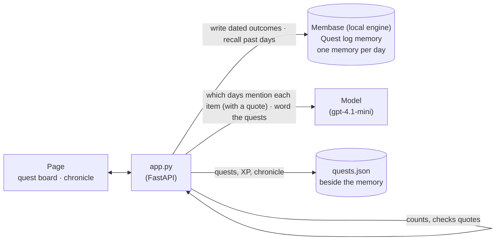

# Quest log

Rin, an invented player, keeps a cozy RPG quest log: tell the scribe the plan for a day in plain
words and it becomes quests with XP. Every quest Rin closes is remembered with its date, and the
past days make up the chronicle. Memory holds three weeks of Rin's days. On each of the last
three Mondays the 7:00 gym session was skipped (a late Sunday, a moved standup, too tired), while
the 18:30 gym sessions on Wednesdays and Fridays were all done. In the video Rin plans next Monday
with *"Gym at 7:00 before work"* on it again. The scribe turns to the past days, the app counts
them, and the gym quest is rewritten to 18:30 with a scribe's note that shows the evidence:
*Mondays at 7:00: skipped on each of the last 3 (Mon 28 Sep, Mon 5 Oct, Mon 12 Oct). Evenings at
18:30: done 4 of 4.* Rin marks it done, and that outcome goes back into memory, dated by its day.

**Base:** the local engine, with one directory per person (`data/10-quest-log/rin/`). Each
outcome is dated by the day it was for, which needs the local engine.

## Video

https://github.com/user-attachments/assets/1080200b-5159-446f-beb0-c6366acaa4d2

59 s · local engine. After a short explainer of how the app and Membase fit together:

1. **Rin plans next Monday.** The chronicle on the right already holds 16 dated days. Rin writes the plan, including *gym at 7:00 before work*, and presses **Draw up the quests**.
2. **The scribe turns to past days.** Memory gives back the past days, each with its date: they get a red bookmark in the chronicle, the Mondays shaded.
3. **The app counts: skipped on each of the last 3 Mondays.** *The scribe's tally*: the 7:00 gym, with a red stamp for each Monday (28 Sep, 5 Oct, 12 Oct), and done 4 of 4 at 18:30. Each counted day gets a margin note in the chronicle with the words memory gave back; hovering a stamp lights that day.
4. **Monday's gym quest is rewritten.** *Go to gym at 18:30*, the planned version struck through, a *Rewritten* ribbon, and the scribe's note with the dates behind it.
5. **Monday evening: Rin goes.** **Done** stamps it *Complete*, adds 30 XP (Rin reaches level 8), and the chronicle gains Mon 19 Oct, remembered with its date.

## How it works

Memory keeps the history. The model reads it, and the app does the counting, so a number on the
screen is never the model's arithmetic.



| What | Where it lives | Written by | Read by |
|---|---|---|---|
| What happened each day, e.g. `SKIPPED: "Morning gym session at 7:00" (body, hard, morning). Note: Standup moved to 8:30…` | `Quest log` memory, one memory per day (or per closed quest), dated by that day | `seed.py` (from the Monday three weeks before the planned one up to yesterday), the page's **Done** and **Skip** | the planner, through recall |
| The game: quests, XP, level, which quests each day had | `quests.json` in the same directory | the app | the page (level and XP in the hero bar, the days in the chronicle) |

The page is the game: a hero bar (Rin, level, XP, streak), the quest board for the planned day
on the left, and the chronicle of past days on the right. The steps:

| Step | What happens on the page | Membase call | Model's job |
|---|---|---|---|
| **1. In memory** | The chronicle lists Rin's past days, each with a mark per quest (filled: done; struck: skipped). Each day is a memory with its date. Closing a quest adds one, dated by the quest's day. | a dated write: the engine's session ingest with the day as its date (`demokit.dated.remember_sessions`) | none |
| **2. Plan** | Rin writes the plan for a day and presses **Draw up the quests**. The plan folds to one line. | none | none |
| **3. Recall and count** | One search for the planned weekday, and one per plan item, side by side. Every hit keeps its date. The days memory gave back get a bookmark in the chronicle (the full passage is the row's tooltip). The model then says which recalled days mention each item, done or skipped, with a quote. The app keeps an outcome only if its quote is really in that day's passage, counts each day once, and counts the same weekday at the same time ("Mondays at 7:00: skipped 3 of 3"). An item is changed only if at least two such days exist and two thirds of them were skipped. For such an item it also finds the time of day that has worked ("Evenings at 18:30: done 4 of 4"). *The scribe's tally* shows the counts as date stamps, and each counted day gets the quote as a margin note in the chronicle (the page says "Rin" where the engine's text says "the user"). | `search`, one for the weekday and one per item | split the plan into items; for each, list the days that report it, with a quote |
| **4. Rewrite** | The quests, with XP by difficulty. Only a flagged item changes. Its card spans the board: the planned version struck through, a *Rewritten* ribbon, and the scribe's note: the model's sentence, then the counted dates. "Each of the last 3" is shown only when the dates are the three weeks before the planned day. | none | write the quests, and for the changed one a note of at most 14 words, with no numbers or dates |

Hover a date stamp in the tally to light that day in the chronicle.

## How Membase serves it

- **One directory per person.** `Membase(local=data/10-quest-log/rin)` answers the SDK calls in
  process with `unibaseio-membase-core`. Another player gets another directory. `quests.json` sits beside it.
- **A day becomes an episode with its date.** The engine reads each day's log into an episode in
  SQLite and FAISS, in its own words ("On Monday 2026-10-05 at 21:00 UTC, the user reviewed their
  quest log… They skipped the morning gym session…"). The app writes through the engine's
  sessions so the episode is dated by the day it describes (its evening), not by the time of the
  write. Seeding writes the 16-21 days side by side in about 10 s; a closed quest can be recalled
  about 5 s later.
- **Search is hybrid retrieval.** Keyword and vector search over the episodes. One search takes
  3-4 s on this engine, so the app runs its six at the same time (about 6 s together). Each hit
  carries its memory id and its date, which the app uses for the weekday, the chips and the
  check of "the last 3".
- **The app counts.** The model only points at passages and quotes them; the counts, the dates
  and the decision to change an item are computed in `app.py`, so the evidence on screen is
  exact.

## Use it

```bash
uv sync                                  # once, at the repo root
uv run 10-quest-log/seed.py              # three weeks of days up to yesterday (about 10 s)
uv run 10-quest-log/app.py               # open http://127.0.0.1:8710
```

Then, on the page:

1. The board opens on the next Monday (the arrows beside the date change the day). Type
   *Gym at 7:00 before work, finish the Atlas slide deck, 15-minute inbox sweep at lunch, call Jun
   about Saturday, read 20 pages before bed* and press **Draw up the quests**.
2. The chronicle's subtitle says *The scribe turned to 16 days · 3 Mondays*, and the days memory
   gave back get a red bookmark.
3. *The scribe's tally* shows the gym: skipped on each of the last 3 Mondays, with a red stamp per
   date, and done 4 of 4 at 18:30. The counted days get a margin note in the chronicle. Hover a
   stamp to light its day. The other items fold away: nothing to change.
4. The quests appear. The gym quest now says something like *Go to the gym at 18:30*, with the planned version
   struck through and the scribe's note with the dates. Press **Done** on it: a *Complete* stamp,
   +30 XP in the hero bar, and Mon 19 Oct at the top of the chronicle. The subtitle says *17 days
   remembered* once memory has it.
5. Plan a Wednesday with the same gym at 18:30, and nothing changes: those days were done.

## API

| Endpoint | Does |
|---|---|
| `GET /api/state` | The game state (days, quests, XP), how many days memory holds, and the next Monday. |
| `POST /api/plan` | Takes `{date, plan}`. Streams the recalled days, then the counted evidence per item, then the quests. |
| `POST /api/quest` | Takes `{date, id, status}` (`done` or `skipped`). Updates the game, and writes the outcome to memory dated by its day, in the background. |

`smoke.py` seeds a fresh directory, plans the next Monday and checks the counted evidence against
what was seeded: the gym skipped on exactly the three Mondays, done on every Wednesday and Friday
at 18:30, and only the gym quest moved, to the evening. It then closes that quest and checks that
memory gives it back with its date.
