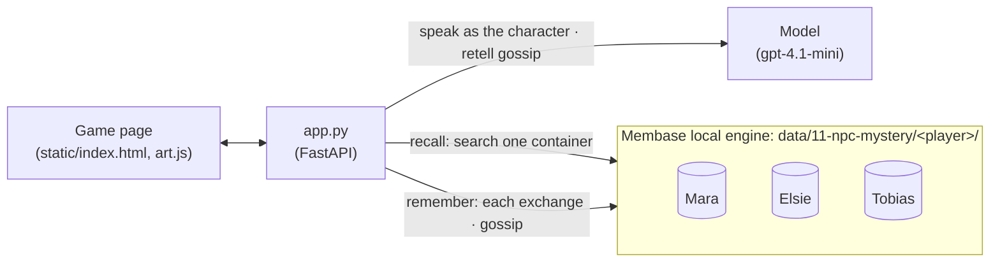

# NPC mystery

A small detective game in a fishing harbour, where each of three characters has a memory of its
own. A character knows what you told it, and what someone else passed on to it, and nothing more.
In the video you tell Mara the innkeeper that you found *a green glass button stamped with an
anchor under the harbour office window*. Later that evening, at the Gull & Lantern, Mara tells her
niece Elsie. Asked about it at the ferry landing, Elsie answers "Mara told me you found a green
glass button…". Tobias the lighthouse keeper, asked the same question, has heard nothing, because
nobody wrote it into his memory. Then you accuse Tobias.

The page is laid out like a visual novel: a drawn harbour behind you, the person you are talking
to in front, a dialogue box at the bottom, and your notebook on the right. The game shows memory
the way such games do: *"Mara will remember that."* after an exchange is written, *"Elsie
remembers what Mara told her."* when her recall finds the gossip, and a clipping in the notebook
with the exact memory she recalled.

The story, *The Dark Lamp at Saltmarsh*, is original. The lighthouse went dark for twenty minutes
in a storm, and the page for that night was torn out of the harbour logbook. Tobias did it, and
he keeps his alibi straight because he recalls what he already told you.

**Base:** the local engine. Each player gets a directory of their own, and each character a
container in it. **New case** starts a new, empty directory.

## Video

https://github.com/user-attachments/assets/3fadbbf1-5c19-4b0d-b49a-0789b9d70b7a

77 s · local engine, one container per character. After a short explainer of how the app and Membase fit together:

1. **Tell Mara** you found a green glass button stamped with an anchor under the harbour office
   window. "Mara will remember that." Her line in the notebook says what you told her.
2. **Later that evening.** At the Gull & Lantern, Mara tells Elsie. The notebook adds what Elsie
   now knows, and from whom; Tobias's line still says he hasn't heard a thing.
3. **Ask Elsie** at the ferry landing. "Mara told me…", and the notebook's clipping shows the
   memory she recalled: Mara's gossip.
4. **Ask Tobias the same** at the lighthouse. He has heard nothing; his memory had nothing about
   you. Then accuse him, and the torn logbook page closes the case.

## How it works



| What | Where it lives | Written by | Read by |
|---|---|---|---|
| What you said to a character and what it said back, one memory per exchange | that character's container (`Mara`, `Elsie` or `Tobias`) | `/api/talk`, after the reply | that character, on every later reply |
| Gossip, e.g. `Mara Quill (Innkeeper …) told Elsie Rook this about the investigator: …` | the listener's container | `/api/gossip`, when time passes | the listener, on every later reply |
| Each character's brief: what it knows and what it hides (`story.py`) | the app's code | the author | the prompt, never memory |
| What was said, who told whom, the accusation (the notebook and the dialogue box) | `game.json` in the player's directory | the app | the page |

The four steps of the story:

| Step | What happens | Membase call | Model's job |
|---|---|---|---|
| **1 · Tell one** | You visit one character (the portraits in the top bar) and talk. It recalls from its own container, answers, and the exchange is written to that container. | `search` (one container), then `memories.add` | speak as the character, from its brief and what it recalled |
| **2 · Gossip spreads** | **Let the evening pass**: the chattiest character who heard something from you tells its confidant. Mara tells her niece Elsie; Elsie and Tobias tell Mara. The retelling is one write into the listener's container. | `memories.add` into the listener's container | retell what you said in the teller's words, keeping every detail |
| **3 · Ask another** | Ask a second character. It recalls only its own container, so it knows the clue only if gossip put it there, and it says who told it. The notebook's clipping shows the memories it recalled. | `search` (one container) | answer, and credit whoever told it |
| **4 · Accuse** | Name the culprit. The case closes and the truth is shown. | none | none |

Replies are capped at three short sentences in the character's voice, and a retelling at two.

The story fixes where gossip goes: each character has one confidant. The model only decides how
the teller puts it. If you tick *People may also pass things on straight after you speak to
them* (on the case card, under **The case** in the top bar), the model also decides, after each
exchange, whether the character passes it on at once.

## How Membase serves it

- **One directory per player.** `Memory("11-npc-mystery", user=<player>)` opens
  `Membase(local=data/11-npc-mystery/<player>)`, which runs `membase-core` inside the app's own
  process. A new game is a new directory, so nobody remembers you.
- **One container per character.** `Mara`, `Elsie` and `Tobias` are containers in that directory.
  The engine creates each one on its first write. A search names one container and sees nothing
  else. That is the whole game: Tobias cannot recall gossip that was written to Elsie.
- **A write becomes episodes.** `memories.add` turns the exchange or the gossip into timestamped
  episodes in SQLite and FAISS in about 4 s, and they can be searched as soon as the call
  returns. The app writes off the request path, one write at a time per player. A character's
  next recall waits for writes still landing in its container.
- **Search** is hybrid keyword and vector retrieval over that container's episodes. The first
  search loads a reranker, which takes 10–30 s once. After that a recall takes about a second.
  A container that has never been written to does not exist yet, and its search returns
  nothing.
- **The liar stays consistent.** Every exchange, including what Tobias said back, is in his
  container. When you ask again, he recalls his own earlier claims before he answers.

## Use it

```bash
uv sync                                  # once, at the repo root
uv run 11-npc-mystery/app.py             # open http://127.0.0.1:8711
```

Then, on the page:

1. The case card opens. Press **Take the case**. You are at the Gull & Lantern with Mara.
2. Tell her: *I found a green glass button stamped with an anchor under the harbour office
   window.* She answers, and a note says *Mara will remember that.* In the notebook, under Mara
   Quill: *you told her: "I found a green glass button…"*.
3. Press **Let the evening pass**. The scene moves into the inn: Mara tells Elsie, in Mara's own
   words. Under Elsie Rook the notebook now says *Mara told her: "…"*; Tobias still *hasn't heard
   a thing*.
4. Press **Go and ask Elsie** and ask *Have you heard anything about what I found under the
   harbour office window?* A note says *Elsie remembers what Mara told her*, she mentions the
   button and Mara, and the clipping *What Elsie remembered* shows the memory she recalled.
5. Press **Tobias Venn** in the top bar and ask the same. *Tobias has heard nothing about you*,
   he has not heard of the button, and the clipping says nobody has told him a thing.
6. Ask Tobias where he was when the lamp went dark, then ask again in other words. His story
   holds. Press **Accuse** and pick a suspect.

## API

| Endpoint | Does |
|---|---|
| `GET /api/story` | The case and the three characters. |
| `POST /api/new` | A new player directory: every character starts with an empty memory. |
| `GET /api/game?player=` | The player's chats, gossip, memory counts per character, and the verdict once accused. |
| `POST /api/talk` | Takes `{player, npc, message}`. Recalls from that character's container, streams the reply, writes the exchange. |
| `POST /api/gossip` | Takes `{player}` (optional `src`, `dst`). Time passes: one character tells its confidant, written to the listener's container. |
| `POST /api/settings` | Takes `{player, auto_gossip}`. Whether characters may also gossip right after you talk (off by default). |
| `POST /api/accuse` | Takes `{player, suspect}`. Closes the case and returns the truth. |
| `GET /api/recall?player=&npc=&q=` | What one character's memory returns for a query. |

`smoke.py` plays the video's path on a fresh data directory: tell Mara, let time pass, check that
the gossip went to Elsie, that Elsie recalls it and credits Mara, that Tobias's memory has
nothing about it, that Tobias recalls his own alibi, and that accusing him solves the case.
