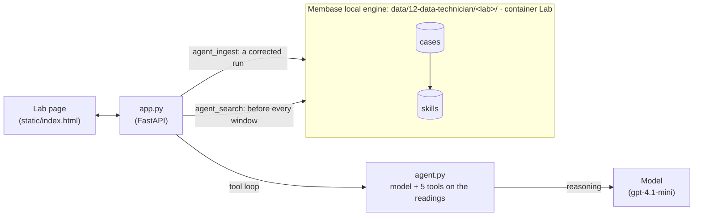

# Data technician

An agent labels windows of sensor readings (clean, spike, drift, flatline or dropout) the way a
technician would: it calls tools that compute on the readings, then answers. This lab has
conventions the model does not know. The page is *Benchlog*, a lab notebook for the probe QC
bench of Dr. Hana Ito (invented). In the video the agent looks at window T01, finds one reading at
robust z 6.1, and stamps it **spike**. Dr. Ito strikes the stamp through and writes why, in one
sentence: *"A lone reading under 8 robust z is ordinary probe noise here, so call it clean; only
8 or more is a spike."* She signs it, and the corrected run is ingested as agent memory: it
becomes a **skill**, filed in the notebook's binder as an SOP card with her note and signature.
Window T07 is the same kind of window. Before the agent starts on it, the SOP is retrieved and
put in its prompt ("Following SOP-01, learned from Dr. Ito, 14 Oct"), and this time the label is
**clean**. Then the validation plate, twelve held-out windows that are never corrected, is
labelled again, and the page shows the score before teaching and after, window by window.

**Base:** the local engine. Agent memory (cases and skills) exists only there today. Each lab is a
directory of its own; **New lab** starts with an empty memory.

## Video

https://github.com/user-attachments/assets/5f7a46a0-493d-477b-8566-6ab0a886fc63

64 s · local engine, agent memory. After a card that shows how the app and Membase fit together:

1. **The QC agent labels T01.** It calls its tools one at a time; each result is inked on the
   plot (the reading at z 6.1 is circled). It stamps the window *spike*. The lab's label is *clean*.
2. **Dr. Ito says why.** She strikes the stamp through and writes the lab's rule in one sentence:
   only a robust z of 8 or more is a spike. She signs it.
3. **The run becomes an SOP.** The agent re-checks with a tool and states the rule; the whole run
   is ingested, and the binder gets SOP-01 with her note, signed *H. Ito, 14 Oct*.
4. **T07, the same kind of window.** "Following SOP-01, learned from Dr. Ito, 14 Oct": the skill
   and the T01 case are retrieved first. The agent checks at z 8 and stamps it *clean*.
5. **The validation plate.** Twelve held-out windows, before and after: 6 of 12 right before
   teaching, 8 after one correction, both measured during the take.

## How it works



| What | Where it lives | Written by | Read by |
|---|---|---|---|
| The windows: 12 training, 12 held-out, with the lab's labels (`windows.py`, fixed seeds) | the app's code | the author | the tools, the grader |
| A corrected run: the tool calls and results, the scientist's sentence, the agent's reply | agent memory, as a **case** (task, what was tried, key insight) | `/api/correct` → `agent_ingest` | `agent_search`, before every window |
| A **skill**: a reusable procedure with decision rules, folded from cases | agent memory | the engine, during `agent_ingest` | `agent_search`; the page's SOP binder (one card per skill) |
| Which windows were taught, each ingest's counts, every held-out score | `lab.json` in the lab's directory | the app | the page |

The page is a lab notebook: the queue of windows on the left, the open window in the middle (its
plot, the run log, the sign-off), the SOP binder on the right. The five steps:

| Step | What happens | Membase call | Model's job |
|---|---|---|---|
| **1 · Label** | The agent inspects the window with at least three tools, one at a time. Each call is a line in the run log, and its result is drawn on the plot (spikes circled with their z, the median, the fitted slope, the longest identical run) (`compute_stats`, `find_spikes`, `slope`, `longest_run`, `view_segment`), and answers with a label. | `agent_search` first (empty memory returns nothing) | choose tools, read the results, label |
| **2 · Correct** | If the label is wrong, the agent's stamp is struck through and the scientist writes the right label and the reason, in the sign-off. The page offers the lab's rule for that kind of window. The agent re-checks with a tool and states the rule. | none | re-check and answer the correction |
| **3 · Learn** | The whole run, correction included, is ingested. The engine extracts a case and adds or updates a skill. A run the agent got right is not ingested: there is nothing to teach. | `agent_ingest` | (the engine's own model calls) |
| **4 · Reuse** | The next window starts with a search on its shape. The skills and cases found go into the agent's prompt as the lab's notes. The page shows the first skill as "Following SOP-01", with the correction it came from, and the case's insight, and marks the SOP card *read for T07*. | `agent_search` | follow the notes |
| **5 · Measure** | The 12 held-out windows (the validation plate) are labelled with whatever memory holds now. The plate shows each window's label before teaching and now, side by side. | `agent_search` per window | label |

## How Membase serves it

- **In process, one directory per lab.** `Memory("12-data-technician", user=<lab>)` opens
  `Membase(local=data/12-data-technician/<lab>)`, which runs `membase-core` inside the app. All
  agent memory goes into one container, `Lab`, under agent id `technician`. The agent verbs are
  not in the public SDK yet, so `demokit.Memory` reaches the local backend for them (the same
  object the `membase agent` command uses).
- **`agent_ingest(messages, agent_id, session_id)`** takes the run as OpenAI-style messages with
  tool calls. The engine splits it into episodes, keeps the ones that show exploration or a user
  correction, extracts a **case** from each (the task, the steps tried, the key insight), and
  folds cases into **skills**: a named procedure with steps and decision rules. One ingest takes
  10–15 s. It returns how many cases were kept, which skills were added or updated, and why
  anything was skipped; the page shows all of it.
- **`agent_search(query, agent_id)`** returns the closest skills and cases, each with a score.
  The query is the window's shape (its spread, NaN count, readings past robust z 4, slope and
  longest identical run), so a window that looks like a taught one finds that lesson. The cases
  go into the prompt first, because each keeps the scientist's correction and its insight word
  for word.
- **What the engine needs before it learns:**
  - At least three tool-call rounds (`MEMBASE_AGENT_MIN_TOOL_ROUNDS`, default 3). Parallel calls
    in one turn count as one round, so the agent calls tools one at a time
    (`parallel_tool_calls=False`).
  - The trace must end on the agent's own turn. A trace that ends on the user's correction is
    rejected as `trajectory_not_closed`, which is why the agent answers the correction before the
    run is ingested.
  - No system message: the engine accepts only user, assistant and tool turns, so the app strips
    the system prompt before ingesting.
  - Maturity scoring is off by default (`MEMBASE_AGENT_SKIP_MATURITY=1`), so one good case can
    make a skill.

## What to expect

Measured on fresh labs; the agent is a model, so the exact numbers move a little between runs.

- **One correction (the video's path):** held-out accuracy went from 6–7 to 8–10 out of 12.
- **Five or six corrections** (`smoke.py`): held-out went from 6–7 to 11 out of 12. What the
  agent gets wrong before teaching is the lab's own conventions: an outlier under 8 robust z, a
  stuck run, a slow warm-up trend, and zero or NaN dropouts.

## Use it

```bash
uv sync                                  # once, at the repo root
uv run 12-data-technician/app.py         # open http://127.0.0.1:8712
```

Then, on the page:

1. Click **Validation plate** at the bottom left, then **Run the plate**. The twelve held-out
   windows are labelled one by one; the *Before teaching* column and the score fill in. Press
   **Back to the queue**.
2. T01 is open. Press **Run QC agent** and watch the run log; each tool's result is drawn on the
   plot. The sign-off shows the agent's stamp. If it is wrong, the stamp is struck through, and
   Dr. Ito's note offers the lab's rule. Keep it or write your own sentence, then press **Sign and
   file**. The agent re-checks, and after about 15 s the sign-off says what was filed. The SOP card
   appears in the binder on the right, with the note and the signature.
3. Pick **T07** (another lone outlier) and run it. "Following SOP-01 … learned from Dr. Ito" shows
   what went into the prompt, and the card in the binder is marked *read for T07*.
4. Teach a few more (T02–T06 each break a different convention), then run the plate again. Each
   row shows the label before teaching and now; rows that turned right are shaded green.

**New lab** (top right) starts a lab with an empty binder.

## API

| Endpoint | Does |
|---|---|
| `GET /api/windows` | The training and held-out windows, and the labels. |
| `POST /api/labs/new` | A new lab directory with an empty memory. |
| `GET /api/lab?lab=` | The lab's record, its skills and its directory (creates the lab if new). |
| `POST /api/classify` | Takes `{lab, window}`. Searches agent memory, runs the tool loop, streams every step and the verdict. |
| `POST /api/correct` | Takes `{lab, run_id, label, reason}`. The agent answers the correction; the run is ingested. Streams the reply, then what was kept. |
| `POST /api/accept` | Takes `{lab, run_id}`. The agent was right: nothing is written. |
| `POST /api/evaluate` | Takes `{lab}`. Labels the held-out batch with what memory holds now. Streams each window, then the score. |

`smoke.py` runs the loop on a fresh data directory: a baseline, up to six corrected runs, and a
second evaluation. It checks that corrected runs became cases and skills and that the second
evaluation retrieved them, and prints both scores. The change is reported, not asserted.

All the data is synthetic and comes from fixed seeds in `windows.py`.
