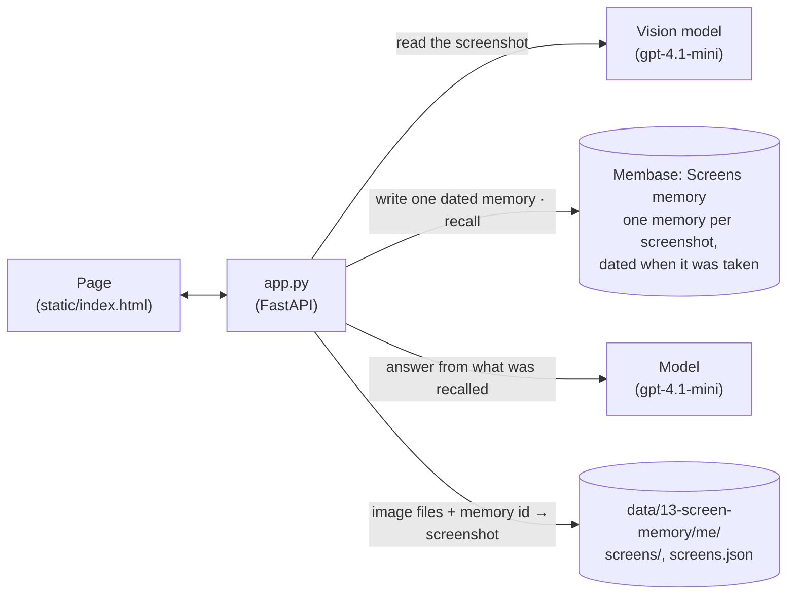

# Screen memory

Jordan Avery (invented) took six screenshots over three weeks: a flight booking on 2 October, a
VPN error and the settings that fixed it on 18 September, an analytics dashboard, an
out-of-office reply and a router's guest Wi-Fi page. The page is *Lookback*, a screenshot library
on a desktop. A vision model reads each screenshot as it comes in, and memory keeps what was on
it, dated when it was taken. Weeks later Jordan opens the search panel and asks *"What was my
flight number?"*. The answer is *SL 482*, and the flight booking opens beside it with "SL 482"
marked on the screenshot. *"How did I fix the VPN error last time?"* gets *switched from IKEv2 to
WireGuard*, and opens the VPN settings of 18 September with the WireGuard setting marked.

**Base:** the local engine only. Each screenshot is written with the time it was taken, which the
local engine accepts; hosted `memories.add` stamps the time of the call.

## Video

https://github.com/user-attachments/assets/36baa455-333c-441d-9c7e-4c0c58214b36

65 s · local engine and a vision model. After a short explainer of how the app and Membase fit together:

1. **Jordan's six screenshots go in.** Each appears in the library while it is read, then shows
   its app, when it was taken and the values read from it.
2. **"What was my flight number?"** in the search panel. *Flight SL 482*; the booking of 2 October
   opens, zooms in, and "SL 482" is marked on it. The other screenshots memory returned are listed
   below the answer.
3. **"How did I fix the VPN error last time?"** *Switched from IKEv2 to WireGuard*, from the VPN
   screenshots of 18 September; the settings screenshot opens with WireGuard marked.

## How it works

The app keeps the image files and a small index (which memory ids belong to which screenshot).
What was on each screen lives in Membase.



| What | Where it lives | Written by | Read by |
|---|---|---|---|
| What was on each screen: app, activity, values, visible text, summary, and when it was taken | `Screens` memory, one memory per screenshot, dated with the capture time | the page, when a screenshot is added | the answer to each question |
| The image and the memory ids its write returned (`screens:3`) | `data/13-screen-memory/me/screens/` and `screens.json` | the page, after the write | the library; turning a recalled memory back into its image |
| Each sample's text layer: every word on it and its box | `samples/text.json`, written by `seed.py` when it renders the samples | `seed.py` | marking where the answer is on the screenshot |
| Worked-out procedures (optional) | agent memory in `Procedures`: cases and skills | **Save as procedure** | the next similar task |

The four steps:

| Step | What happens | Membase call | Model's job |
|---|---|---|---|
| **1 · Screenshot** | A screenshot comes in: one of the six samples, or one you drop, paste or choose, with the time it was taken. | none | none |
| **2 · Read** | The vision model reads it: the app, what kind of screen, what was happening, every value on screen, the visible text and a two-sentence summary. | none | vision: return that as JSON |
| **3 · Remember** | The reading becomes **one** memory in `Screens`, dated when the screenshot was taken. The write returns the memory ids, which the app links to the image. The library shows the new screenshot, with its app and the values read from it. | dated session write (`demokit.dated.remember_sessions`) | none |
| **4 · Ask** | Your question, typed in the search panel, is a search over `Screens`. Each hit's memory id leads back to its screenshot (S1, S2, …). A model answers in at most ten words from those memories and names the screenshots it used. The panel lists every screenshot memory returned (the cited ones marked *Used*) and opens the cited one whose values the answer quotes, with the passage memory returned for it. | `search` | answer from the recalled memories and cite `[S1]` |

The answer can only cite a screenshot whose memory was recalled for this question. The page
shows the passage memory returned for the open screenshot, so you can check the answer against
it.

**Marking the place.** An OS that searches screenshots keeps the text it recognised on each one.
Here the six samples carry that text layer from `seed.py`, which records every word and its box
as it renders them. When the answer quotes a value the vision model read from the cited
screenshot ("SL 482"), `app.py` finds that value in the text layer and returns its boxes; failing
that, it looks for the answer's codes and names (words with a capital or a digit, such as
"WireGuard"). Only the most prominent matches are kept. The page dims the rest of the screenshot,
marks the boxes, and zooms in when they sit close together. A screenshot you add yourself has no
text layer, so it opens without marks.

**Redo a task (optional, *Redo a task* in the sidebar).** An agent with two tools,
`search_screens` and `open_screen`, works out steps across several screenshots. If you push back
("that did not work"), it looks again. **Save as procedure** gives the run to the local engine's
agent memory, which keeps it as a case and a skill when the run shows exploration or a
correction and used at least three tool rounds. A later similar task gets that procedure first.
It is not in the video.

## How Membase serves it

- **The local engine runs in the app's process.** `Membase(local=data/13-screen-memory/me)` is
  `unibaseio-membase-core`. One directory is one person's memory, which is how an app on the local engine
  keeps its users apart (`me` here).
- **A screenshot is a dated session.** The app writes the reading as a one-turn session whose
  `session_date` is the capture time, the same thing `memories.add` does but with the date given
  instead of now. The engine turns it into episodes stamped with that date (stored in SQLite and
  FAISS) and returns their ids. This takes about 5 s, and the memory is searchable as soon as
  the call returns. There is no learning run to wait for.
- **Search** is hybrid keyword and vector retrieval over the episodes. Each hit carries
  `source: episode:<memory id>` and its `session_date`. The app maps the id to its screenshot.
- **Model calls** (vision, answers, and the engine's own extraction and embeddings) use your
  `OPENAI_API_KEY`. Nothing else leaves the machine.
- **Agent memory** (`agent_ingest`, `agent_search`, `agent_skills`) is a local-engine feature: a
  run's messages and tool calls become cases, and repeated cases become skills.

## Use it

```bash
uv sync                                   # once, at the repo root
uv run 13-screen-memory/app.py            # open http://127.0.0.1:8713
```

Then, on the page:

1. The library is empty. Press **Import 6 screenshots from Desktop**. Each one appears while it
   is read (*Reading…*, then *Remembering…*); then its app, when it was taken and a few values
   read from it show under it (about 8 s each). The sidebar lists the apps.
2. Click **Ask your screenshots** in the toolbar (or press ⌘K / Ctrl+K). Ask *What was my flight
   number?* The answer says SL 482. Under it, the screenshots memory returned; the booking is
   marked *Used* and opens on the right, zooming in on "SL 482", with what memory recalled for
   it underneath. Click another row to open that screenshot.
3. Ask *How did I fix the VPN error last time?* The answer says you switched from IKEv2 to
   WireGuard and cites the VPN screenshots (S3, often S2 too). The settings screenshot opens with
   the WireGuard setting marked.
4. Click a screenshot in the library to see everything read from it and the memory it became.
5. Try your own: **Import** in the toolbar takes a dropped, pasted or chosen screenshot and when
   it was taken. You can also drop images onto the library.
6. Optional: open **Redo a task** in the sidebar, start the VPN task, reply "That did not work:
   I'm on a cafe network and WireGuard still won't connect. What else did I set up?", then
   **Save as procedure**. Start "VPN says the handshake timed out at the airport lounge. How do I
   get it working?": the assistant gets the saved procedure first.

The sample PNGs and their text layer are checked in under `samples/`. To render them again, run
`python 13-screen-memory/seed.py` with any Python that has Playwright and Chromium.

## API

| Endpoint | Does |
|---|---|
| `GET /api/samples` | The six sample screens, their capture times, and whether each is in memory. |
| `POST /api/samples/add` | Takes `{file}`. Streams `read` (the vision model's reading), then `remembered` (the screen's record and memory ids). |
| `POST /api/screens` | A multipart upload (`file`, optional `captured_at`). Reads and remembers it; returns the record. |
| `GET /api/screens` | Every remembered screenshot, with its reading and memory ids. |
| `POST /api/ask` | Takes `{question}`. Streams the recalled memories, the answer, then `done`: the screenshots it cites, the one to open, and the marked places on each (`regions`, fractions of the image). |
| `POST /api/howto`, `/api/howto/save`, `GET /api/howto/skills` | The optional how-to agent and its agent memory. |

`smoke.py` runs on a fresh store: the six samples in, two questions answered from the right
screenshots with the capture time on the recalled memory, the right one opened with the place
marked, then a corrected how-to run saved and reused.
