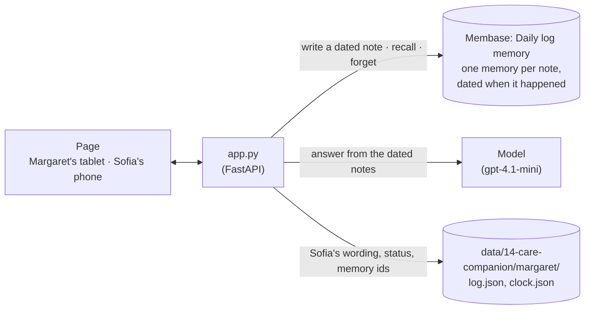

# Care companion

A memory aid for someone who forgets the day. Margaret (invented) has memory loss; Sofia, her
caregiver, logs what happens as it happens: pills, meals, visitors, appointments. The page is
*Hearth*, two devices on a kitchen table. Margaret's tablet is a day clock in large, high-contrast
type ("Tuesday afternoon") with her three questions as big buttons. Sofia's phone holds the care
log. It is Tuesday, 12:30. Margaret taps *"Did I take my pills this morning?"* and hears *"Yes,
you took your morning pills at 8:15 this morning with breakfast"*, from today's note, although
every day of the week has a pills note. She taps *"When is my next doctor visit?"* and hears
*Thursday at 10:30*. Then the surgery moves the visit: Sofia edits the note on her phone to
Friday 14:00. The old memory is forgotten and the new one written; the log keeps the old note
crossed out, and when Margaret asks again she hears *Friday*.

This is a demo with a made-up person, family and care notes. It is not a medical device, a
reminder service or a substitute for care.

**Base:** the local engine only. Each note is written with the time it happened, which the local
engine accepts; hosted `memories.add` stamps the time of the call.

## Video

https://github.com/user-attachments/assets/550171b0-4ef9-4c7c-93cf-3dcb2b37d02c

65 s · local engine. After a card that shows how the app and Membase fit together:

1. **Sofia keeps Margaret's care log** on her phone, beside Margaret's tablet.
2. **"Did I take my pills this morning?"** Yes, at 8:15, under *Sofia's note, today, 08:15*. Sofia's phone gets a notice of the question and marks the note the answer came from.
3. **"When is my next doctor visit?"** Thursday 15 October at 10:30.
4. **Sofia edits the note** on her phone: Friday 16 October, 14:00. The Thursday note stays in the log, crossed out: *Forgotten · moved to Fri 14:00*.
5. **Margaret asks again:** Friday at 14:00. Under the answer, the Thursday note is struck through: *Sofia moved it, so I forgot the old note.*

## How it works



| What | Where it lives | Written by | Read by |
|---|---|---|---|
| Each care note, e.g. *Margaret's care log, Tuesday 13 October 2026, 08:15. Medication: Morning pills taken with breakfast.* | `Daily log` memory, one memory per note, dated when it happened | `seed.py` (a week of 29 notes); Sofia on her phone | every answer |
| Sofia's own wording, each note's status (saving, saved, forgotten) and its memory ids | `log.json` beside the memory | the app, after each write or correction | the phone's care log; mapping a recalled memory to its note; an edit knows which memory to forget |
| The demo clock, "now" | `clock.json` | `seed.py`: the most recent Tuesday at 12:30 | the time worked out in every answer |

The page shows both devices at once: Margaret's tablet on the left, Sofia's phone on the right.

| Step | What happens | Membase call | Model's job |
|---|---|---|---|
| **1 · Log** | Sofia writes a note with the time it happened. | none | none |
| **2 · Remember** | The note becomes one memory, dated with that time (in the background; the phone shows *Telling Margaret's companion…* for 3–8 s). | dated session write (`demokit.dated.remember_sessions`) | none |
| **3 · Ask** | Margaret's question is searched twice: as asked, and with today's and yesterday's dates written out. Each recalled note is labelled with its date and how it relates to now ("today, earlier", "yesterday", "in 2 days"). A model answers from those notes and names the ones it used. | `search` (2 queries) | read the labels, answer in under 22 warm words, cite the note |
| **4 · Correct** | Sofia taps the note on her phone, changes it and presses **Save change**. The new memory is written first, then the old one is forgotten. The old note stays in the log crossed out (*Forgotten · moved to Fri 14:00*); when Margaret asks again, the answer changes, and the tablet strikes through the old note under it. | dated write, then `memories.forget` on each of the old note's memory ids | none |

The time is worked out from the labels, not guessed: "this morning" is today before noon,
"yesterday" is the day before, and "next" is the soonest note still to come. The tablet shows
the notes the answer used under it (*Sofia's note, today, 08:15*), and the phone marks them in
the log (*In Margaret's answer just now*). After a correction, the tablet says it forgot the old
note only if recall no longer returned that note's memory; if recall still returned it, the
tablet says so instead.

## How Membase serves it

- **The local engine runs in the app's process.** `Membase(local=data/14-care-companion/margaret)`
  is `membase-core`. One directory is one person's memory, so a care app on the local engine
  keeps each person apart by giving each a directory.
- **A note is a dated session.** The app writes it as a one-turn session whose `session_date` is
  when it happened, the same thing `memories.add` does but with the date given. The engine turns
  it into episodes with that date (SQLite and FAISS) and returns their ids
  (`daily-log:12`). The note is searchable as soon as the write returns, about 3–8 s.
- **Search** is hybrid keyword and vector retrieval over the episodes. Each hit carries its
  memory id and `session_date`, which is where the relative label comes from.
- **Forget** is `memories.forget(id, confirm=True)`: the episode is deleted, so search can no
  longer return it. A correction writes the new note before it forgets the old one, so if the
  write fails, the old note stays as it was.
- **Model calls** (answers, and the engine's own extraction and embeddings) use your
  `OPENAI_API_KEY`. Nothing else leaves the machine.

## Use it

```bash
uv sync                                    # once, at the repo root
uv run 14-care-companion/seed.py           # a week of notes; the demo clock is Tuesday 12:30
uv run 14-care-companion/app.py            # open http://127.0.0.1:8714
```

`seed.py --reset` starts over. The seed writes 29 notes in about 15 seconds. The demo clock is a
fixed "now" (the most recent Tuesday at 12:30), so the week reads the same whenever you open the
page, and the follow-up with Dr. Reyes is always on Thursday.

Then, on the page:

1. The tablet on the left reads *Tuesday afternoon, 13 October · 12:30*. The phone on the right
   shows Sofia's log: what is coming up (Dr. Reyes on Thursday, the dentist next week), today and
   the days before.
2. On the tablet, tap **Did I take my pills this morning?**. The answer says yes, at 8:15, with
   *Sofia's note, today, 08:15* under it. On the phone a notice says what Margaret asked, and
   today's 08:15 note is marked *In Margaret's answer just now*.
3. Tap **When is my next doctor visit?**. The answer says Thursday at 10:30.
4. On the phone, tap the Dr. Reyes follow-up under *Coming up*. In the sheet, change the text to
   Friday at 14:00, set **When** to Friday 14:00, and press **Save change**. The old note stays
   in the log, crossed out: *Forgotten · moved to Fri 14:00*. The tablet says Sofia has just
   changed a note.
5. Tap **When is my next doctor visit?** again. The answer now says Friday, and under it the
   Thursday note is struck through: *Sofia moved it, so I forgot the old note.*

**Note** on the phone adds a note of any kind, dated when it happened. On the tablet, **Ask
something else** takes a question of your own.

## API

| Endpoint | Does |
|---|---|
| `GET /api/state` | The person, the demo clock, and every log entry with its status. |
| `POST /api/entries` | Takes `{kind, text, when}`. Logs a note and writes its memory in the background. |
| `POST /api/entries/{id}/correct` | Takes `{kind, text, when}`. Writes the corrected note, then forgets the old note's memories. |
| `POST /api/ask` | Takes `{question}`. Returns the answer, the notes it cites, and every recalled note with its date label. |

`smoke.py` seeds a fresh store and asks the "this morning", "yesterday" and "next" questions,
checking the note each answer cites. It then corrects the appointment and checks that the next
answer says Friday, cites only the new note, and never the old one.
