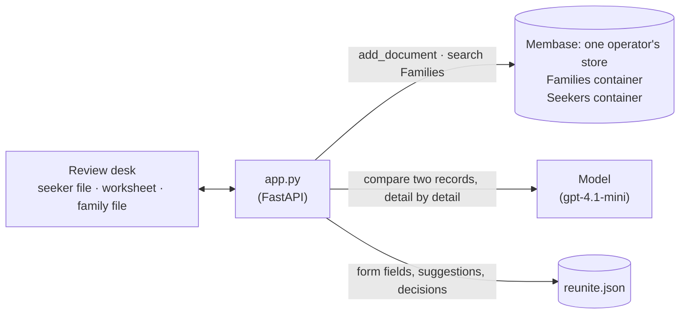

# Reunite

Two people's memories of the same childhood, matched for a person to review. Ruth Marsh lost
touch with her little brother Dani in 1989 and describes him: *"a red tin toy fire truck our
grandfather gave him, with a ladder that wound up on a handle"*, a brown spaniel called
Biscuit, a flat above the bakery. Callum Price, adopted in 1990, describes what he remembers:
*"a little metal fire engine, red, with a ladder you could crank up"*, a floppy-eared dog called
Bisky or Biscuit, the smell of warm bread coming up through the floor. Memory finds Ruth's
family record among ten and the model scores it 90.

The page is a caseworker's review desk. Callum's file lies open on the left, the family's file
on the right, and the reviewer's worksheet between them. Every detail that agrees is highlighted
in both files under the same pencilled number, and the worksheet lines the pairs up side by side.
A conflict would be underlined in red pencil. Only the reviewer can put down the stamp: *Match*
or *Not a match*.

**Every person, family and town here is synthetic. This is a demo, not a tracing or
reunification service. The system only suggests; a person decides.**

**Base:** the local engine, one operator's own store. Matching reads every family's record for
every seeker. On hosted Membase each person would have their own account, and reading across
accounts would cross the tenant boundary. So this runs as one operator (an agency's
caseworker) holding both kinds of record in one local store.

## Video

https://github.com/user-attachments/assets/d81d8124-bd24-43de-804d-63c5abb89611

59 s · local engine, one operator's store. After a short explainer of how the app and Membase fit together:

1. **What Callum remembers.** The notice pinned across the desk: every file is synthetic, this is not a tracing service, a person decides. Then Callum's file, in his own words, and the fire engine he remembers.
2. **Pull the family files that could fit:** six searches of the family files, the top five scored. F-01 comes first at 90, on an index card.
3. **Both files side by side.** F-01 opens on the right. *"A little metal fire engine, red, with a ladder you could crank up"* is pair 1 on the worksheet, beside *"A red tin toy fire truck our grandfather gave him, with a ladder that wound up on a handle"*, and both phrases carry a green ① in their files. The dog, the sister, the song, the bakery and the scar follow, each numbered the same way in both files.
4. **A person decides.** The reviewer writes a note and stamps *Match*: *S-01 · F-01, reviewed by a person*.

## How it works



| What | Where it lives | Written by | Read by |
|---|---|---|---|
| A family's record: the child, how they lost touch, looks and marks, toys, people, places | `Families` container, one document per record | `seed.py`, the intake form | matching, through search |
| A seeker's record: earliest memories, objects, people, places, marks | `Seekers` container, one document per record | `seed.py`, the intake form | the page (the seeker's own words) |
| Each record's form fields, the suggested matches, the reviewer's decisions | `reunite.json` beside the memory | the app | the page |

The worksheet in the middle of the desk takes the reviewer through four steps, one at a time:

| Step | What happens | Membase call | Model's job |
|---|---|---|---|
| **1 · Seeker** | The seeker's file, in their own words, open on the left. | none (written earlier with `add_document`) | none |
| **2 · Recall** | Six searches of `Families`: the seeker's whole account, then each kind of detail on its own (earliest memories, objects, people, places, marks). The hits are mapped to family records and fused by rank. The worksheet ticks off each search. | `search` ×6 | none |
| **3 · Compare** | The top five families, each compared with the seeker: details that plausibly describe the same thing (≈), details that contradict (≠), a score and one line for the reviewer. Paraphrases count: "a little metal fire engine" ≈ "a red tin toy fire truck". The top five show as index cards; opening one puts the family's file on the right, with each compared phrase marked in both files under the pair's number. | none | the comparison and the score |
| **4 · A person decides** | The reviewer reads the pairs, writes a note and stamps the family *Match* or *Not a match*. Only a person's decision is recorded as a match; **withdraw** takes it back. | none | none |

The score is a suggestion. In the seeded data the highest score for a seeker with no true family
is about 65 (S-10 against a family that shares a fiddle and a mountain village), which is why a
person decides.

## How Membase serves it

- **Local engine.** `Membase(local=data/15-reunite/operator)` runs `membase-core` in the app's
  process. The operator's directory holds two containers, `Families` and `Seekers`.
- **Documents.** Each record is written with `add_document` and its id as `custom_id`
  (`reunite:F-01`). The engine reads it into a topic tree (SQLite and FAISS), about 8 s per
  record, and it can be searched as soon as the call returns.
- **Search** is hybrid keyword and vector retrieval. A hit names the document it came from, and
  the app maps that to the family record. Searching once per kind of detail lets a family that
  matches on one specific thing (the toy, the scar) rank even when the rest of the account
  reads differently. The slip clipped to the bottom of the family's file
  (*Pulled from memory by …*) shows the passages each search brought back.
- **Why not hosted.** On hosted Membase the account is the tenant boundary. Families and
  seekers would be separate people with separate accounts, and no key can search across
  accounts. A real service would need a deliberate design for that (consent, an operator
  account that holds the records); this demo keeps it to one operator's local store.

## Use it

```bash
uv sync                                  # once, at the repo root
uv run 15-reunite/seed.py                # 10 families, 10 seekers, matches suggested (about 3 minutes)
uv run 15-reunite/app.py                 # open http://127.0.0.1:8715
```

`seed.py --records-only` writes the records without matching (about 1.5 minutes), so you can
watch matching run on the page. `seed.py --reset` starts over. The seed has three true pairs,
F-01/S-01, F-02/S-02 and F-03/S-03, where the seeker describes the same details in their own
words. It also has decoys: a family from the same seaside town as S-01, a blue plastic fire
engine, a flood in another year, and seekers who share one detail with some family.

Then, on the page:

1. **S-01 Callum Price** opens on the desk: his file on the left, an empty worksheet in the
   middle, no family file yet on the right. The tabs along the top are the other seekers.
2. Press **Pull family files that could fit** (or **See the 5 files pulled last time** if the
   seed matched them). The worksheet ticks off six searches; after 30–60 s five index cards
   appear, F-01 first with a score near 90 circled in red pencil.
3. Click the **F-01** card. Ruth's file for Daniel opens on the right. The worksheet pairs the
   toy, the dog, the sister who braided his hair, the song, the bakery, the sea and the scar, and
   the same numbers mark those phrases in both files. The strip above the family's file switches
   to the other four candidates.
4. Write a note on the **Reviewer's note** line and press **Match**. The stamp comes down:
   *S-01 · F-01, MATCH, reviewed by a person*, with your note beside it. The S-01 tab gets a red
   dot.
5. Try **S-10**: its best candidate is a decoy. Read the conflicts (red wavy underlines) before
   deciding.
6. **New file** opens an intake form. Describe a memory in your own words; a new seeker is
   written and matched. A new family marks earlier matches as out of date.

## API

| Endpoint | Does |
|---|---|
| `GET /api/fields` | The form fields for families and seekers. |
| `GET /api/queue` | Every seeker with its match status, best suggestion and decisions. |
| `GET /api/seekers/{id}` | A seeker's record, the match status and phase, the compared candidates (pairs, score, the passages search returned), and decisions. |
| `POST /api/seekers/{id}/match` | Recalls and compares again in the background. |
| `POST /api/records` | Takes `{kind, fields}`. Writes a record to memory; a seeker is then matched. |
| `POST /api/reviews` | Takes `{seeker_id, family_id, decision, note}`: `match`, `no_match` or `undecided`. |

`smoke.py` seeds a fresh store and reports where each true family ranks for its seeker, after
recall and after comparison. It fails unless all three are in the top three, unless the S-01
and F-01 pairs include the fire engine and the fire truck, and unless a review decision is
recorded. Last run, local engine, `gpt-4.1-mini`: recall top-1 3/3, compared top-1 3/3,
true-pair scores 90, 90, 90.
