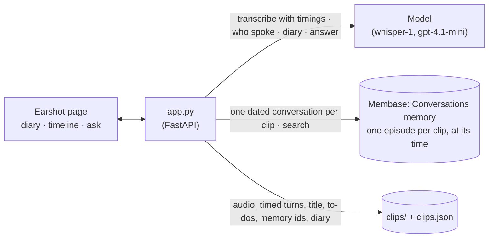

# Wearable diary

A day of audio from a clip-on recording pendant becomes conversation memory. The page is
*Earshot*, the pendant's companion app. Alex, an invented designer, wears the pendant through a
Wednesday: a stand-up at 09:30, lunch with Jordan at 12:40, a hallway chat with Priya at 15:10
and a call from Sam at 17:15. Syncing the pendant brings each clip in: it is transcribed with
its timings, the model says who spoke each line, and the conversation is remembered at the time
it was recorded. The day gets a short diary entry and a timeline of conversations with their
waveforms and your to-dos. Ask *"What did I promise Sam?"* and the answer is one line: Saturday
at 9, with the car. Under it is the 17:15 call, open at the line where Alex promised, ready to
play. Ask *"What time is the design review?"* and the answer is 3:30, not 3:00: the stand-up
said three, and the 15:10 chat moved it. Both clips are shown, the later one marked as the one
that changed it.

The sample day is synthetic speech, made with text-to-speech in five voices. Alex, Priya,
Marco, Jordan and Sam are made up. If you record, record only yourself or people who have
agreed to it.

**Base:** the local engine only. Each conversation is written with the time its clip was
recorded, and that needs the local engine (`demokit.dated`).

## Video

https://github.com/user-attachments/assets/b5b698eb-2aa7-48b6-affd-1b0e71b64f9a

62 s · local engine and speech-to-text. After a card that shows how the app and Membase fit together:

1. **A day on the pendant.** Earshot, with nothing from today yet. **Sync from the pendant**
   brings in four clips. Each card fills in as its clip is transcribed, split by speaker
   (the waveform takes each speaker's colour) and remembered at its time. The diary entry for
   Wednesday is written above them.
2. **"What did I promise Sam?"** Saturday 9:00 AM with the car, tape and the trolley, and the
   photos that night. The 17:15 call opens at Alex's line "I promise I'll be at yours at nine with my
   car…", marked on its waveform, and plays from there.
3. **"What time is the design review?"** Thursday at 3:30 PM in the Atlas room. "Priya changed
   it at 15:10, from Thursday at 3 PM." The 09:30 stand-up ("Thursday at 3 in the afternoon") and the 15:10
   chat ("pushed to 3.30") are both shown, and both light up on the day's timeline.

## How it works



| What | Where it lives | Written by | Read by |
|---|---|---|---|
| Each clip's conversation: the speaker turns ("Me", Priya, Sam…), dated at the clip's time | `Conversations` memory, one conversation per clip | the app, after transcribing and splitting | the answer, through search |
| The audio, the transcript, the turns with their start and end times, the title, summary and to-dos, the clip's memory ids | `clips/` and `clips.json` beside the memory | the app | the timeline, the player, and the link from a recalled memory to its clip |
| The day's diary entry | `diary-<date>.json` beside the memory | the app, from the day's clip summaries and to-dos (not from memory) | the page, until the day's clips change |

The steps:

| Step | What happens | Membase call | Model's job |
|---|---|---|---|
| **1 · Capture** | A clip arrives with the time it was recorded: the sample day (**Sync from the pendant**), an upload or a browser recording (**Record**). Its card appears on the timeline with the real waveform of its audio. | none | none |
| **2 · Transcribe** | Speech to text, with each segment's start and end. The model says who spoke each numbered segment; consecutive segments by one speaker become a turn, keeping its times. The wearer is "Me"; others are named when the talk names them ("it's Sam"). | none | transcribe; label each segment's speaker; a title, a summary and the to-dos |
| **3 · Remember** | The turns are written as one conversation, dated at the clip's time. The engine returns its memory ids, which link it back to the clip. When the day's clips are all in, the diary entry is written. | the local engine's dated session write | the diary: two or three sentences from the clips' summaries and to-dos |
| **4 · Ask** | Search over the conversations. The hits are numbered in the order they happened and the model answers in one short line, says which conversations it used, which one changed an earlier answer and what it was before. Each cited hit maps to its clip. In each clip, the turn that shares the most words with the answer and the question (a word counts more the fewer turns say it) is quoted and marked on the waveform, and **Play** starts there. | `search` | answer from the numbered conversations; name the conversation that changed it and what it was |

The answer only cites clips through memory: a clip is shown because search returned a memory
from it and the model used that memory. Each card also shows that memory ("Remembered: …"),
without the engine's leading date clause, since the card shows the time. The line "Priya changed
it at 15:10, from Thursday at 3 PM." is put together by the app: who spoke the quoted line of the clip the
model named, that clip's time, and what the model said it was before. **Forget** (under a
conversation's time, on hover) forgets its memories and deletes its audio, and search stops
returning it.

## How Membase serves it

- **Local engine.** `Membase(local=data/16-wearable-diary/me)` runs `membase-core` in the app's
  process. One directory is one wearer's memory; an app for many wearers gives each their own.
- **Dated conversations.** A clip goes in as a conversation session with `session_date` set to
  when it was recorded, not when it was processed. The engine turns it into an episode that
  keeps that date, and it can be searched about 5 s later. That date is what lets the answer
  tell the 09:30 stand-up from the 15:10 chat that changed it.
- **Search** is hybrid keyword and vector retrieval over the episodes. Each hit keeps its date
  and memory id.
- **Forget** removes each of the clip's memory ids (`memories.forget`).

## Use it

```bash
uv sync                                       # once, at the repo root
uv run 16-wearable-diary/seed.py --audio-only # make the four sample clips (TTS, then checked)
uv run 16-wearable-diary/app.py               # open http://127.0.0.1:8716
```

Text-to-speech does not always say the line it is given (one take came out as "Okay, I guess
I'll bring the tape" in place of the promise to Sam), so `seed.py` transcribes each clip it
makes and makes it again until the lines the demo asks about can be heard. `--reuse DIR` copies
clips made before instead.

Then, on the page:

1. Earshot opens on today with nothing synced and a drawing of the pendant. Press **Sync from
   the pendant**. Four cards appear on the timeline with their waveforms in grey; each says
   *Transcribing…*, *Working out who spoke…*, *Remembering…* and then shows its title, its
   speakers and your to-dos, the waveform in each speaker's colour (about 30 s for all four).
   The bar at the top says *Syncing 4 conversations*, then *Synced · last at 17:15*. The diary
   entry for the day appears above the timeline.
2. Ask **What did I promise Sam?** The answer says Saturday at 9:00. Below it is the 17:15 call,
   with Alex's promise quoted and marked on the waveform. Press **Play from 0:11**: the playhead
   runs through the marked line. Click anywhere on the waveform to play from there.
3. Ask **What time is the design review?** The answer says Thursday at 3:30, and under it *Priya
   changed it at 15:10, from Thursday at 3 PM.* The 09:30 stand-up is tagged *Was …*, the 15:10 chat
   *Changed it*, and both light up on the timeline on the left.
4. Optional: press **Record** to record a conversation in the browser or add an audio file with
   the time it was recorded, then ask about it.

`seed.py` without `--audio-only` also puts the day in memory from the command line.
`--reset` starts over.

## API

| Endpoint | Does |
|---|---|
| `GET /api/clips?date=` | The day's clips (status, title, speakers, timed turns, duration, summary, to-dos, memory ids), and whether the sample audio exists. |
| `POST /api/clips` | Multipart `audio` and `when`. Saves the clip, then transcribes, splits and remembers it in the background. |
| `POST /api/sample-day` | Adds the four sample clips as today's. |
| `GET /api/diary?date=` | The day's diary entry, once its clips are all processed (`ready`). |
| `GET /api/clips/{id}/audio` | The clip's audio. |
| `POST /api/clips/{id}/forget` | Forgets the clip's memories and deletes its audio. |
| `POST /api/ask` | Takes `{question}`. Returns the answer, `change` and `was` when a later clip changed it, the cited clips (each with the recalled passages, the `moment` to play from and `changed_it`), and everything recalled. |

`smoke.py` uploads the four clips through `POST /api/clips`, waits for them, reads the diary
and asks both questions. It checks that the Sam answer cites 17:15, says Saturday at nine and
plays from the promise; that the design review answer says 3:30 on Thursday, marks the 15:10
clip as the one that changed it, says it was 3 before, plays the 15:10 clip from "pushed to
3.30", and cites 09:30 too. Then it forgets the lunch clip and checks that search no longer
returns it.
