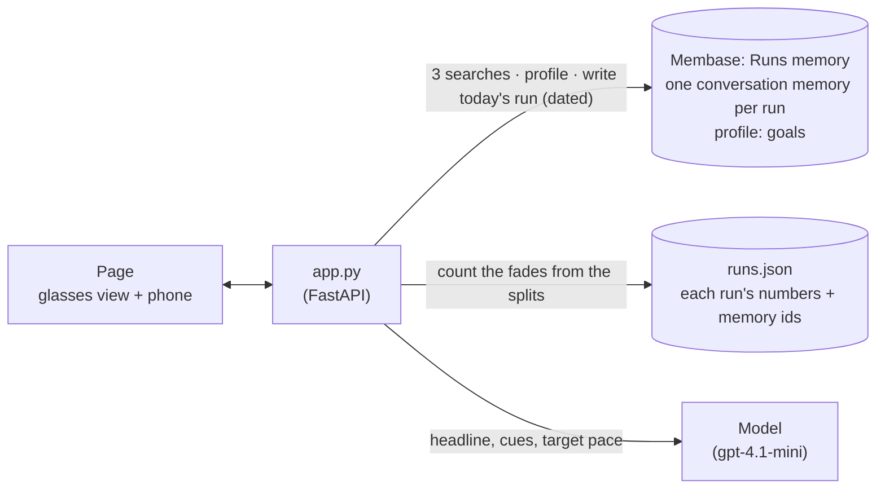

# Run coach HUD

A running coach for smart glasses that remembers your past runs. The page is *Pacenote*: the
view through the glasses on a park path, with pace, distance, time and heart rate at the edges
of the lens, and the phone companion app in your hand before and after the run. Jamie, an
invented runner training for a half marathon, has ten runs in memory from the last four weeks.
Every one of the five runs over 7 km started too fast and faded after km 7. Before today's
10 km, the phone shows the brief: the coach read those runs from memory, and code counted the
fades from their splits, "5 of 5". At km 6.5 the cue appears in the lens: *"5 of your last 5
runs over 7 km faded after km 7. Hold 5:18 now."*, with the five runs drawn as split charts,
each with its date and how much it slowed. Today Jamie holds the pace, and the phone shows the
run saved to memory. The next brief reads it: now 5 of 6, and the latest held.

The runner, the runs and the goals are synthetic, and the run is a simulation. The simulated
runner holds the target pace from the brief. This is a demo, not training or medical advice.

**Base:** the local engine only. Each past run is written with the date it was run, and that
needs the local engine (`demokit.dated`).

## Video

https://github.com/user-attachments/assets/bba27630-6be4-4621-a147-3401925e9183

53 s · local engine. After a card that shows how the app and Membase fit together:

1. **Before the run: the brief.** On the phone: 10 km steady, 5:18 /km target, a one-line read
   of the last run, *Read your last 10 runs*, and *5 of 5 runs over 7 km faded after km 7* with
   the five runs, each a small split chart that drops after km 7.
2. **The run, through the glasses.** The phone goes away and the path moves. At km 6.5 the cue
   appears in the lens with the five runs it counted, by date and how much each slowed.
3. **Saved to memory.** Back on the phone: today's 10 km, its splits held after km 7, and
   *Saved to your runs*.
4. **The next brief reads it.** *Today* is at the top of the list, marked *held*, and the count
   reads 5 of 6: the latest held.

The fade count is computed from each run's splits, not by the model.

## How it works



| What | Where it lives | Written by | Read by |
|---|---|---|---|
| Each run's summary: date, splits, heart rate, how it felt | `Runs` memory, one dated conversation memory per run | `seed.py` (ten runs), the page at the end of a run | the brief, through search |
| Jamie's goals: the half marathon target, the easy-run heart rate limit | the profile (standing facts) | `seed.py` | the brief |
| Each run's numbers and its memory ids | `runs.json` beside the memory | the same writes | the fade count and the split charts, for the runs search returned |

The steps:

| Step | What happens | Membase call | Model's job |
|---|---|---|---|
| **1 · Brief** | Three searches bring back the recent runs; the goals come from the profile. Code maps each recalled memory to its run's splits and counts the runs over 7 km that faded after km 7 (km 8 on at least 15 s/km slower than km 3–7). The phone shows the count and each counted run's splits. | `search` ×3, `profile` | write a one-line headline, two short cues that cite runs by number, and the target pace. It is given the count and told not to count itself. |
| **2 · The run** | A simulated run streams into the HUD at the lens edges, and the drawn path moves at the runner's pace. The cue at km 6.5 is built from the count and shows every run it counted, as a split chart with its date. Other cues (start, a heart rate limit) come from the model. The simulation waits 3 s after a cue at a km, so the cue is read near that km. | none | none |
| **3 · Remember** | The finished run's summary is written to memory, dated now. The phone shows the run and its splits, then *Saved to your runs*. | the local engine's dated session write | none |
| **4 · Next brief** | The same searches now return today's run too. The count becomes 5 of 6, the latest held, and today's run tops the list. The headline compares today's run with the ones before it. | `search` ×3, `profile` | as in step 1 |

The count is code, not model arithmetic. The model sees it as a line in its input, and the
smoke test checks every "N of M" the brief states against seed.py.

## How Membase serves it

- **Local engine.** `Membase(local=data/17-run-coach-hud/jamie)` answers in the app's own
  process with `membase-core`. Each directory is one runner's memory, which is how an app on
  the local engine keeps its users apart.
- **Dated memories.** A run summary goes in as a one-turn conversation session with its own
  `session_date`, so a run seeded "14 days ago" is remembered on that day, not on the day the
  seed ran. The engine turns it into an episode and returns its memory id. Today's run is
  written the same way, dated now, and can be searched about 5 s later.
- **Search** is hybrid keyword and vector retrieval over the episodes. Each hit keeps its date
  and memory id. The brief sorts the hits by date, newest first, and the memory id links each
  hit to the run's numbers.
- **Profile.** The goals are standing facts (`memories.add(static=True)`), read with
  `profile()`.

## Use it

```bash
uv sync                                  # once, at the repo root
uv run 17-run-coach-hud/seed.py          # ten runs over four weeks, and two goals (about 10 s)
uv run 17-run-coach-hud/app.py           # open http://127.0.0.1:8717
```

`seed.py --reset` starts over. Then, on the page:

1. You stand at the start of a park path, seen through the glasses, with the phone in front.
   The phone shows the brief: *10 km steady*, *5:18 /km target*, *Read your last 10 runs*, and
   *5 of 5 runs over 7 km faded after km 7* above the five runs, each with its date, a split
   chart that drops after km 7 and how much it slowed. In the lens, the plan: *10 km steady
   run · 5:18 /km*.
2. Press **Start run**. The phone goes away; the path moves and the HUD counts up: distance with
   a bar marked at km 7, time, pace against the target, heart rate. The run takes about 25 s.
   Just after km 6.5 the cue appears in the lens with the five runs it is based on.
3. At the finish the path slows to a stop and the phone comes back with the run: time, average
   pace and heart rate, the splits (the bars after km 7 in green: no fade) and *Saved to your
   runs*.
4. Press **Next run's brief**. *Today* tops the list, marked *held*, and the count reads 5 of 6:
   *The latest held.*
5. Optional: pick **5 km**. A short run gets no km 6.5 cue, because the fade only happened on
   runs over 7 km.

## API

| Endpoint | Does |
|---|---|
| `POST /api/brief` | Takes `{distance_km, kind}`. Recalls runs and goals, counts the fades, and writes the brief. Returns cues, moments, the count (with each counted run's splits) and the recalled runs. |
| `POST /api/run` | Takes `{brief_id}`. Streams the simulated run (ticks, splits, cues), then writes the run to memory and sends `saved`. |
| `GET /api/runs` | The run log and the goals. |

`smoke.py` seeds a fresh store and checks that the km 6.5 cue states the count worked out from
seed.py and cites every counted run, that every count in the brief is true, that the cue fires
before km 7, that the run is saved, and that the next brief recalls it and counts 5 of 6.
