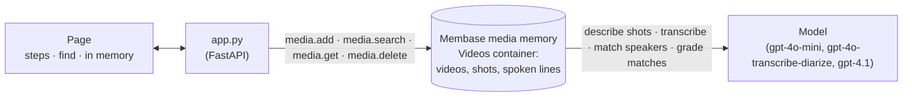

# Video memory

Recall any scene or line in a video. When a video is added, Membase's media memory remembers
each scene (where it starts and ends, and what is in it) and each spoken line (its words, its
time and who on screen says it). Ask for a scene or a line and the video plays from that second.

Four steps run along the top: *Add*, *Scenes*, *Lines*, *Recall*. *Scenes* and *Lines* work while
a video is being added. On the right, each video in memory is drawn as two tracks, its scenes and
its lines. Two Blender
open movies are in memory already; the Sintel trailer is added on the page (about 20 s). *"a
little dragon flying toward a hand"* finds the trailer's shot at 0:33, which plays from there.
*"the old man says it's not safe here"* finds the line at 0:57 of Elephants Dream, *"Get up,
Emo. It's not safe here"*, said by *the older bald man with sideburns*. Under the player the
video is laid out as memory holds it, with the matched shot or line lit up and the playhead
moving through it.

**Shows:** media memory (`membase.media`): a video remembered as its shots and its spoken lines,
each with its time and speaker, and found by what was seen or what was said.

**Base:** the local engine with the `[media]` extra (`unibaseio-membase[media]`). Media memory
runs on the local engine only today.

The videos are the Blender Foundation's open movies, *Elephants Dream* (2006), *Tears of Steel*
(2012) and *Sintel* (2010), all CC BY.

## Video

https://github.com/user-attachments/assets/557b1808-7558-4b5b-83b3-248e254bef16

62 s. After a short explainer of how the app and Membase fit together:

1. **2 films in memory.** Elephants Dream and Tears of Steel, each drawn as its scenes and its
   lines. **Add** the Sintel trailer: it is remembered, and its card arrives with its scene and
   line counts.
2. **Recall a scene.** *"a little dragon flying toward a hand"*: Sintel, 0:33. It plays
   from that second, and the trailer's shot track lights the shot up.
3. **Recall a line.** *"the old man says it's not safe here"*: Elephants Dream, 0:57,
   "Get up, Emo. It's not safe here", said by the old man on screen. It plays, and the line
   lights up on the line track, coloured by its speaker.

## How it works



| Step | What happens | Membase call |
|---|---|---|
| **1 · Add** | A video arrives: one of the samples (**Add**), or your own file. | `media.add` |
| **2 · Scenes** | A frame every second; a new shot starts where the picture changes (colour and layout). The middle frame of each shot is described. | inside `media.add` |
| **3 · Lines** | The sound is transcribed with the speakers told apart. For each speaker, frames from their turns go to a vision model, which says which person on screen is talking. Runs alongside *Scenes*. | inside `media.add` |
| **4 · Recall** | The words are matched against every shot and line, by meaning and by keyword; a model grades the candidates and only relevant moments come back, grouped by video. The best one plays; the others are listed. | `media.search` |

Everything about a video, its shots, lines, speakers and times, comes from media memory. The app
draws it and plays it; it keeps nothing of its own.

## Use it

```bash
uv sync                                       # once, at the repo root
uv pip install 'unibaseio-membase[media]'     # media memory (local engine, Python 3.12+)
uv run 18-video-memory/seed.py                # fetch the three videos, add two of them (~2 min)
uv run 18-video-memory/app.py                 # open http://127.0.0.1:8718
```

`seed.py` downloads the videos once into `data/18-video-memory/videos/` and makes the two long
films 480p MP4. `--fetch` only downloads, `--reset` empties memory, and `--reuse DIR` copies
videos fetched before.

Then, on the page:

1. Press **Add** beside *Sintel (trailer)*. *Scenes* and *Lines* show what they are working on;
   the trailer's card arrives with its tracks.
2. Type something you saw or something someone said: *a little dragon flying toward a hand*,
   *the old man says it's not safe here*, *a giant robot on a bridge*. The best moment plays; click a shot or line on the tracks to play it instead.
3. Drop your own video on the page, or use **add your own video**.

## API

| Endpoint | Does |
|---|---|
| `GET /api/memory` | The videos in memory, each with its shots (time, end, description, thumbnail) and lines (time, end, text, speaker); the sample videos not added yet; videos being added; totals. |
| `POST /api/samples/{key}` | Adds a sample video, in the background. |
| `POST /api/upload` | Multipart `file`: adds your own video, in the background. |
| `DELETE /api/videos/{id}` | Forgets a video: its shots, lines and file leave media memory. |
| `POST /api/find` | Takes `{q}`. The matching moments, best first, grouped by video: time, end, `seen` or `said`, text, speaker, thumbnail. |
| `GET /files/...` | The videos (with range requests, for seeking) and thumbnails. |

`smoke.py` adds the two films with `seed.py` and the trailer through `POST /api/samples`, then
finds a shot in each film and the old man's line. It checks the video, the time and, for the
line, that the speaker is the old man; fetches a video by range as the player does; then
forgets Tears of Steel and checks that it is no longer found.
