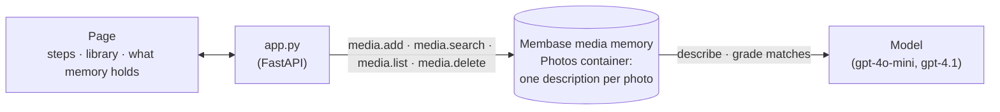

# Photo memory

Recall a photo by describing it. When a photo is added, Membase's media memory looks at it and
remembers what is in it, in one sentence. Describe a photo and memory finds it. Nothing is tagged
by hand.

Three steps run along the top: *Add*, *Remember*, *Recall*. The library holds two albums, Lisbon
and Home; the Kyoto album is added on the page, and *Remember* counts its photos as each is
remembered. The side panel shows a photo and the sentence memory
holds for it. *"rows of orange gates"* finds Fushimi Inari, just added. *"something sweet we
ate"* finds the custard tart and the birthday cake, and nothing else.

**Shows:** media memory (`membase.media`): a photo remembered as a description of what is in it,
and found by what you remember of it.

**Base:** the local engine with the `[media]` extra (`unibaseio-membase[media]`). Media memory
runs on the local engine only today.

## Video

https://github.com/user-attachments/assets/dfc0ccb1-e478-4549-abd8-12e83bc55bf2

51 s. After a short explainer of how the app and Membase fit together:

1. **10 photos in memory.** **Add** the Kyoto album: its four photos are remembered, each with
   its sentence.
2. **Recall a photo.** *"rows of orange gates"*: Fushimi Inari, the photo just added.
3. **Vague works too.** *"something sweet we ate"*: the custard tart and the birthday cake, and
   none of the other twelve.

## How it works



| Step | What happens | Membase call |
|---|---|---|
| **1 · Add** | A photo arrives: an album of samples (**Add**), or your own file. | `media.add` |
| **2 · Remember** | A vision model describes the photo in one sentence: what is in it, what is happening, where. That sentence is what memory keeps. | inside `media.add` |
| **3 · Recall** | Your words are matched against every description, by meaning and by keyword; a model grades the candidates and only relevant photos come back, best first. | `media.search` |

## Use it

```bash
uv sync                                       # once, at the repo root
uv pip install 'unibaseio-membase[media]'     # media memory (local engine, Python 3.12+)
uv run 19-photo-memory/seed.py                # fetch the photos, add Lisbon and Home (~30 s)
uv run 19-photo-memory/app.py                 # open http://127.0.0.1:8719
```

`--fetch` only downloads; `--reset` empties memory. Then, on the page:

1. Press **Add 4 photos** beside *Kyoto*.
2. Describe a photo: *rows of orange gates*, *something sweet we ate*, *an animal having a
   nap*. Matches light up
   in the library, numbered; the best one opens on the right. Click any photo to see what memory
   holds for it.
3. Drop your own photo on the page, or use **+ add your own photo**.

## API

| Endpoint | Does |
|---|---|
| `GET /api/memory` | The photos in memory (album, title, image, description), the albums not added yet, what is being added. |
| `POST /api/albums/{album}` | Adds an album's sample photos, in the background. |
| `POST /api/upload` | Multipart `file`: adds your own photo, in the background. |
| `DELETE /api/photos/{id}` | Forgets a photo: its description and its file leave media memory. |
| `POST /api/find` | Takes `{q}`. The matching photos, best first. |
| `GET /files/...` | The photos. |

`smoke.py` adds Lisbon and Home with `seed.py` and Kyoto through `POST /api/albums`, then checks
that the gates, the two sweet things (and only them) and the sleeping cat (not the running dog)
are found; then forgets the cat and checks that it is no longer found.

## Photos

From Wikimedia Commons, downloaded at 1280 px. No changes beyond resizing.

| Album | Photo | Author | Licence |
|---|---|---|---|
| Lisbon | [Tram in Alfama](https://commons.wikimedia.org/wiki/File:Tram_28_in_Alfama_(Lissabon_2016)_(26029557541).jpg) | Paul Arps from The Netherlands | CC BY 2.0 |
| Lisbon | [Pastéis de nata](https://commons.wikimedia.org/wiki/File:Pasteis_de_nata_(Lissabon_2016)_(26069956686).jpg) | Paul Arps from The Netherlands | CC BY 2.0 |
| Lisbon | [Bridge at sunset](https://commons.wikimedia.org/wiki/File:Ponte_25_de_Abril_at_sunset_01.jpg) | Pedro Simões from Lisboa, Portugal | CC BY 2.0 |
| Lisbon | [Tiled house fronts](https://commons.wikimedia.org/wiki/File:House_fronts_with_azulejos,_Lisbon_-_49721178411.jpg) | Sonse | CC BY 2.0 |
| Lisbon | [Cat on a bench](https://commons.wikimedia.org/wiki/File:Cat_sleeping_on_a_bench,_Prazeres_Cemetery,_Lisbon,_Portugal_julesvernex2.jpg) | Jules Verne Times Two | CC BY-SA 4.0 |
| Lisbon | [Belém Tower](https://commons.wikimedia.org/wiki/File:Torre_Bel%C3%A9m_April_2009-4a.jpg) | Alvesgaspar | CC BY-SA 3.0 |
| Home | [Birthday cake](https://commons.wikimedia.org/wiki/File:Italy_-_birthday_cake_with_candles_5.jpg) | Francesca Cesa Bianchi, Milano | CC BY-SA 3.0 it |
| Home | [Dog on the beach](https://commons.wikimedia.org/wiki/File:A_dog_running_on_the_beach.jpg) | Bruce Emmerling | CC BY-SA 4.0 |
| Home | [Green bicycle](https://commons.wikimedia.org/wiki/File:Green_bicycle_leaning_on_the_wall.jpg) | www.Pixel.la Free Stock Photos | CC0 |
| Home | [Rain on the window](https://commons.wikimedia.org/wiki/File:Rain_on_a_window_pane.jpg) | Theactivistuk | CC BY-SA 4.0 |
| Kyoto | [Fushimi Inari](https://commons.wikimedia.org/wiki/File:20181110_Fushimi_Inari_Torii_12.jpg) | Balon Greyjoy | CC0 |
| Kyoto | [Bamboo grove](https://commons.wikimedia.org/wiki/File:Arashiyama_Bamboo_Grove_(Unsplash).jpg) | Erol Ahmed erol | CC0 |
| Kyoto | [Ramen](https://commons.wikimedia.org/wiki/File:Ramen_Bowl_2.jpg) | Shisma | CC BY 4.0 |
| Kyoto | [Kinkaku-ji pond](https://commons.wikimedia.org/wiki/File:Rokuon-ji_(Kita-ku_Kyoto)_Kinkaku-ji_Pond_hdsr_S5_02.jpg) | Hyppolyte de Saint-Rambert | CC BY 4.0 |
